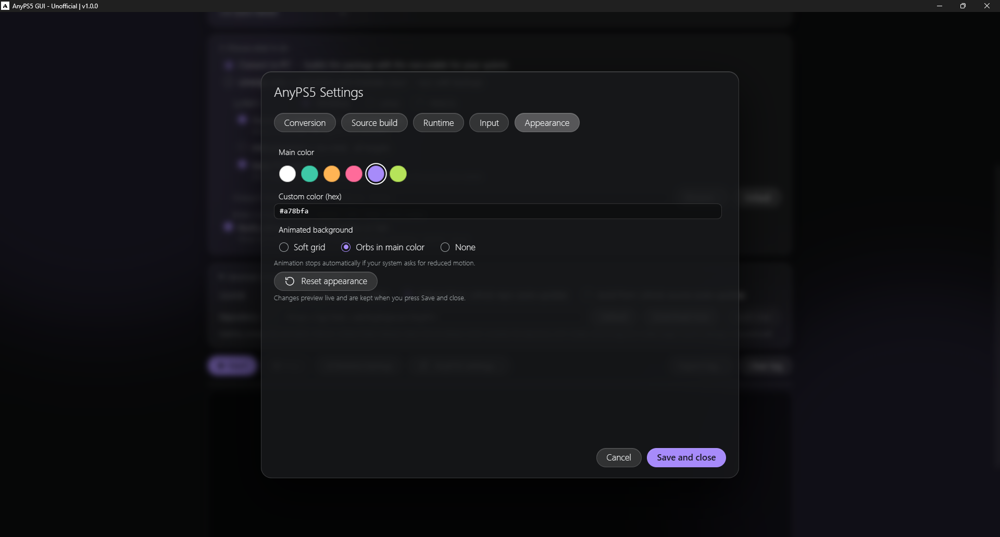

# AnyPS5 GUI

[](LICENSE)
[](https://github.com/Lenny4250gh/AnyPS5-GUI/releases/latest)
[](https://github.com/Lenny4250gh/AnyPS5-GUI/actions/workflows/build.yml)

A graphical interface for [AnyPS5](https://github.com/boykopovar/AnyPS5): unwrap, relink and run without touching the command line.

> **Unofficial.** Not affiliated with Sony or with the AnyPS5 project. This tool contains **no games, no firmware, no keys and no decryption**. Use it only on software you legitimately own (your own dumps or homebrew).

## What is this for?

[AnyPS5](https://github.com/boykopovar/AnyPS5) is a command-line project that takes a **PS5 game dump you own** and turns it into a program that runs natively on a PC (Windows, Linux or macOS). It does this in a few separate steps, each with its own tool and its own options: unwrapping the executables, relinking them against replacement system libraries, and launching the result with the right environment variables.

**AnyPS5 GUI** puts all of that behind a normal window:

- **No command line.** You pick a folder, press a button, read the log.
- **Everything in one place.** The tools (relinker, system libs, `unwrap_self.py`) are downloaded or built for you, kept up to date and checked before every run.
- **Safe defaults, explained options.** Every relinker option has a short description and is automatically disabled when it does not fit the selected target (e.g. Windows-only flags).
- **From dump to launch.** After converting, the same app launches the game, creates a shortcut and edits the controller mapping.

In short, the typical flow is:

```
game dump (folder / .zip / .rar)
        │  Unwrap   (SELF/fSELF → ELF, with backup)
        ▼
   Relink  ──►  <GAME>-<system>/   (app0 + libs + executable)
        │
        ▼
   Launch / shortcut   (runtime settings + input mapping)
```

The GUI does **not** do the conversion itself: it drives the official AnyPS5 tools and shows what they do.

## Highlights

What you get besides "a window instead of a command line":

- **Interactive input editor.** Click a button on the controller, press a key, mouse button or wheel direction, done. Alternate inputs, stick deadzones and mouse-as-stick (sensitivity, curve, smoothing, decay) are all in the same screen. Prefer text? Edit `anyps5-input.ini` directly, with a validity check.
- **Share your settings as a file.** Export any section (conversion, runtime, input) as a small file and import someone else's. Handy to help a friend, or to post a working setup for a game.
- **Use any repository, not only the official one.** Point the GUI at a fork, a branch or an older tag and it downloads that release or builds it from source. Each repository gets its own folder, so testing a fork never mixes files with the official one. See [Using a different repository](#using-a-different-repository-forks-and-custom-builds).
- **Tools handled for you.** Relinker, system libs and `unwrap_self.py` are downloaded (checked with SHA-256) or built, and kept up to date.
- **Options that make sense.** Every relinker option is explained and disabled automatically when it does not fit the selected target.
- **Safe unwrap.** Original files are backed up, with a *Restore backup* button.
- **Runtime settings and shortcuts.** GPU, language, present mode, fonts, tracing and more, passed to the game as environment variables, or saved in a shortcut.
- **Self-updating.** The app checks this repository's latest release and can replace itself and restart.

## Download (no build needed)

1. Open the [**Releases**](https://github.com/Lenny4250gh/AnyPS5-GUI/releases/latest) page.
2. Download the file for your system:

   | System  | File                                                  |
   | ------- | ----------------------------------------------------- |
   | Windows | `AnyPS5_GUI-windows.exe`                              |
   | Linux   | `AnyPS5_GUI-linux` (then `chmod +x AnyPS5_GUI-linux`) |
   | macOS   | `AnyPS5_GUI-macos.zip`                                |

3. *(Optional but recommended)* verify the file: compare its SHA-256 with the `sha256:` value GitHub shows next to each file on the release page:
   - Windows (PowerShell): `Get-FileHash .\AnyPS5_GUI-windows.exe -Algorithm SHA256`
   - Linux: `sha256sum AnyPS5_GUI-linux`
   - macOS: `shasum -a 256 AnyPS5_GUI-macos.zip`
4. Run it. The first time it creates an `AnyPS5_GUI` folder in your user data folder (so it survives updates), where it keeps the downloaded tools (relinker, libs, `unwrap_self.py`), `config.ini`, backups and so on. You can move it from **Settings → Storage**. To keep everything next to the program instead, put an empty file named `portable` next to it (in that mode the folder is called `Utilities/`).

   | System  | Default app folder                          |
   | ------- | ------------------------------------------- |
   | Windows | `%APPDATA%\AnyPS5_GUI` (Roaming)            |
   | macOS   | `~/Library/Application Support/AnyPS5_GUI`  |
   | Linux   | `~/.local/share/AnyPS5_GUI`                 |

All three files are built automatically by GitHub Actions on real Windows, macOS and Linux machines, straight from the source in this repository. You can inspect the [workflow](.github/workflows/build.yml) and the [build runs](https://github.com/Lenny4250gh/AnyPS5-GUI/actions).

### Upgrading from an older version

The first versions kept a `Utilities/` folder next to the program. On startup the app moves it automatically to the new location (your user data folder, or the one chosen in **Settings → Storage**):

- Only what the app itself uses is moved: tools (`unwrap_self.py`, `relinker-*`, `prx-*.zip`, `tools/`), `config.ini`, `anyps5-input.ini`, backups, fonts and 7-Zip files.
- Items that already exist in the new folder are not overwritten, and any other file you left in the old folder stays where it is.
- The old folder is removed (sent to the trash) only if nothing else is left in it.
- The big folders `release/`, `source/`, `toolchain/`, `extracted/` and `update/` are moved only if the old and new folders are on the same drive; otherwise they stay behind and are downloaded or rebuilt when needed.

### Requirements and warnings

- **Windows:** needs the Microsoft Edge WebView2 runtime (already present on up-to-date Windows 10/11). SmartScreen or your antivirus may warn about the file: it is not code-signed, and PyInstaller one-file programs are often flagged as false positives. If you don't trust the binary, read the source and [build it yourself](#build-from-source) (it takes a minute).
- **macOS:** the app is not signed. Right-click the app → **Open** the first time (or run `xattr -cr AnyPS5_GUI.app`).
- **Linux:** the binary bundles Qt, but it still needs a few system libraries. On Debian/Ubuntu: `sudo apt install libegl1 libgl1 libxkbcommon-x11-0 libxcb-cursor0 libdbus-1-3`.

## Quick start

1. Open the app and go to **Convert a game**.
2. Check the **requirements**: the app tells you what is missing and can download the tools for you.
3. Pick your game folder (your own dump), or a `.zip` / `.rar` of it: archives are extracted automatically.
4. Run **Unwrap** if your files are decrypted SELF/fSELF, then **Relink**. The result is a `<GAME>-<system>` package next to the game.
5. Go to **Play a game** and press **Launch**, or create a shortcut.

Settings (runtime, input, appearance) can be changed at any time from their tabs.

## Features

**Convert a game**
- **Unwrap:** already-decrypted SELF/fSELF → ELF, using the official `unwrap_self.py` (the original files are backed up, with a *Restore backup* button).
- **Relink:** builds the `<GAME>-<system>` package (app0 + libs + executable) for Windows, Linux or macOS.
- **Game archives:** the game can be a folder or a `.zip` / `.rar` (`.rar` needs 7-Zip installed).
- **Requirements check:** shows what is missing before you start, and downloads the tools for you when needed.
- **Tools source:** choose where the relinker, libs and `unwrap_self.py` come from (see [below](#where-the-tools-come-from)).
- **Options:** all relinker options, each marked with the systems it applies to. Options that do not fit the selected target are disabled automatically.
- **Audit:** runs `import_audit.py` (if present) after the relink.

> 
> 

**Play a game**
- **Launch** a converted game with your current settings, or **create a shortcut** that starts it with the right variables.

> 

**Settings**
- **Conversion settings**
> 

- **Runtime settings:** Language, GPU, present mode, fonts, tracing and more, passed to the game as environment variables.
> 

- **Storage:** see where the app keeps its tools, builds, backups and `config.ini`, and move everything to another folder with one click.
- Any section of the settings can be exported as a shareable file.

**Updates**
- The app checks the latest release of this repository and, when a newer one exists, can download it for your system, replace itself and restart.

**Input**
- Visual controller editor: click a button, then press a key, mouse button or wheel direction. Alternate inputs supported.

> 

- Stick deadzones and mouse-as-stick settings (sensitivity, curve, smoothing, decay).
> 

- Import / export your settings, or edit `anyps5-input.ini` directly in text view (with validity check).
> 

**Appearance**
- Choose the main color (presets or custom hex) and the animated background (soft grid, orbs or none). It stops automatically if your system asks for reduced motion.

> 

### Where the tools come from

The relinker, libs and `unwrap_self.py` are chosen in **Advanced: where the tools come from** (Convert a game page):

| Source | What it does |
| ------ | ------------ |
| **Local files (manual)** | Uses the files you provide. Press **Import files…** and pick `unwrap_self.py`, `relinker-*` and `prx-*.zip` (optionally `import_audit.py` and `pad_input.py`): they are copied into the app folder (see [Download](#download-no-build-needed)). If a file already exists you are asked whether to replace it. |
| **Release from GitHub repo (auto-update)** | Downloads the latest release (or a tag you choose) of a GitHub repository (**Download now**). |
| **Build from GitHub source (auto-update)** | Clones the repository and builds it (**Build now**); needs git, CMake and a C/C++ compiler. |

Only the controls that apply to the selected source are shown. By default both GitHub sources point to the official [AnyPS5](https://github.com/boykopovar/AnyPS5) repository, but the repository is just a setting: see the next section.

## Using a different repository (forks and custom builds)

The **Repository URL** field is not tied to AnyPS5. You can point the GUI at a **fork** or at any repository that follows the same layout, and the app will download its releases or build it from source. This is useful to try a fork with extra fixes, a branch that is still in development, or an older version.

### Settings

| Setting | Used by | Meaning |
| ------- | ------- | ------- |
| **Repository URL** | Release, Build | Accepts `https://github.com/owner/repo`, `github.com/owner/repo` or just `owner/repo`. Empty = the official AnyPS5 repository. The **Release** source only works with `github.com` URLs; the **Build** source also accepts any URL `git` can clone (`https`, `ssh`, `git`, `file`, `user@host:path`). |
| **Release tag** | Release | Empty = latest release. Set e.g. `v0.1.2` to pin a version. |
| **Check for a newer release before every run** | Release | ON = asks GitHub which release is current and downloads only the missing files. OFF = reuses what was already downloaded (works offline). |
| **Branch or tag** | Build | Empty = the repository's default branch. |
| **CMake target** | Build | Empty = tries the target `relinker` first and, if it does not exist, builds everything. Also used as the name of the executable to pick up. |
| **Extra CMake arguments** | Build | Added to the configure step, e.g. `-G Ninja -DCMAKE_CXX_COMPILER=clang++`. |
| **Check for updates before every relink** | Build | ON = fetches the latest commit and rebuilds only if it changed. OFF = reuses the existing build. |
| **Build the libs (.prx) from the repository** | Build | ON = also builds the `libs` target and uses those libs instead of a `prx-*.zip`. Much slower (full CMake configuration, downloads FFmpeg, needs the SDL/Vulkan build dependencies). |

Each repository gets its own folder, so switching between the official repo and a fork does not mix files:

```
AnyPS5_GUI/              (the app folder)
├── release/<repo>/<tag>/    files downloaded from a GitHub release
├── source/<repo>-<hash>/    clone + CMake build of a repository
└── ...                      files imported manually (Local source)
```

### What a repository must contain

#### For the **Release** source

The GUI asks the GitHub API for the release (`latest`, or the tag you set) and looks at its **assets** by name. Names are matched case-insensitively:

| Asset | Required | Rules |
| ----- | :------: | ----- |
| `relinker-*` | yes | The relinker executable **for the OS the GUI runs on**. On Windows it must end in `.exe`; on Linux/macOS it must have no extension (so `relinker-v0.1.2` is fine, `relinker-v0.1.2.zip` or `.md`, `.txt`, `.json`, `.sha256`… are ignored). If several match, the last one in alphabetical order (the newest version) is used. |
| `prx-*.zip` | yes | The system libs. The zip must contain a folder named `libs` or `libs-<system>` (`libs-windows`, `libs-linux`, `libs-macos`; the system-specific one is preferred). The zip is read as it is, no need to extract it. If the name contains `windows` or `linux` the right one is chosen for the selected target (**macOS uses the `linux` zip**); otherwise any `prx-*.zip` is used. |
| `USAGE.md`, `INPUT_MAPPING.md`, `release-notes.md` | no | Small documentation files, downloaded if present. |
| `unwrap_self.py` | no (see below) | Not read from the assets. |

`unwrap_self.py` is **not** a release asset: it is downloaded from `tools/unwrap_self.py` **at the same tag** of the repository. If that tag does not contain it, the GUI falls back to the default branch (and warns you); if it is not there either, it falls back to the copy in the app folder.

Downloads are verified against the SHA-256 that GitHub publishes for each asset. If GitHub cannot be reached, the release already downloaded is reused. GitHub allows about 60 API requests per hour without a token: set the `GITHUB_TOKEN` (or `GH_TOKEN`) environment variable to raise the limit.

Minimal example of a compatible release:

```
v1.2.3
├── relinker-v1.2.3.exe        (Windows build of the relinker)
├── relinker-v1.2.3            (Linux/macOS build, no extension)
├── prx-windows-v1.2.3.zip     (contains libs/ or libs-windows/)
├── prx-linux-v1.2.3.zip       (contains libs/ or libs-linux/)
└── USAGE.md                   (optional)
```

and, in the repository at the same tag: `tools/unwrap_self.py`.

#### For the **Build from source** option

The GUI runs `git clone --recurse-submodules --depth 1` (adding `--branch <ref>` if you set one), then CMake in `Release` mode. Your repository needs:

- A **`CMakeLists.txt` in the root**. Without it the build stops with an error.
- A CMake target that produces the relinker executable, by default named **`relinker`** (or set your own in *CMake target*). The GUI finds the built executable by looking for a file whose name contains the target name. If the target does not exist and you did not set one, it builds everything and searches again.
- Support for the CMake option **`-DANYPS5_RELINKER_ONLY=ON`**, which the GUI passes automatically so the relinker is built without SDL, Vulkan and FFmpeg. (If you pass your own `-DANYPS5_RELINKER_ONLY=…` in the extra arguments, yours wins.)
- The AnyPS5 folder layout: the folders `core/`, `3rdparty/`, `cmake/` and `tools/` are expected. A missing one is only a warning, but a very different layout probably will not work.
- **`tools/unwrap_self.py`**, used for the Unwrap step (the cloned copy replaces the one in the app folder).
- Optional: `tools/pad_input.py` (controller helper) and `tools/import_audit.py` (audit after relink), picked up from the clone if present.

If you also enable **Build the libs from the repository**, the repo must have a CMake target **`libs`** whose output goes to `<build>/core/libs/libs/*.prx`. Only the `.prx` files that match the folder names under `core/libs/prx/` are kept, the same selection as the official `tools/package_release.py`.

The build is remembered by **commit and target**: if the commit did not change and you did not change the target, the existing relinker is reused and nothing is rebuilt.

**Tools needed to build.** `git`, `cmake` and a C/C++ compiler must be in your `PATH` (on Debian/Ubuntu: `sudo apt install git cmake build-essential`). On Windows the project supports only the MinGW-w64 GCC 15.2.0 (WinLibs, with Ninja) toolchain, and the GUI can install git, CMake and that toolchain for you with one click (the toolchain is about 270 MB, saved in `toolchain/` inside the app folder). Visual Studio cannot link this project.

### Quick checklist for a fork

1. Fork [AnyPS5](https://github.com/boykopovar/AnyPS5) and push your changes; don't rename `tools/unwrap_self.py`, the `relinker` target or the top-level folders.
2. **To test from source:** in the GUI choose *Build from GitHub source*, enter `your-name/AnyPS5` as the repository, optionally a branch in *Branch or tag*, then press **Build now**.
3. **To distribute a version:** create a GitHub release and attach `relinker-<version>[.exe]` and `prx-<system>-<version>.zip` files named as in the tables above. Anyone can then choose *Release from GitHub repo*, enter your repository and get it.
4. Switching back to the official repository is just a matter of clearing the field.

> Only point the GUI at repositories you trust: both options download and then **run** code (the relinker, and `unwrap_self.py`) from that repository on your computer.

## Build from source

Requires Python 3.9+ (3.11 is what the CI uses).

```
git clone https://github.com/Lenny4250gh/AnyPS5-GUI.git
cd AnyPS5-GUI
pip install -r requirements.txt
python AnyPS5_GUI.py          # run directly
```

To build the executable you also need PyInstaller and Pillow:

```
pip install pyinstaller pillow
python build.py               # asks for the target OS
python build.py 3             # no questions: 1 = Windows, 2 = macOS, 3 = Linux
```

`build.py` embeds `index.html` into the executable and calls PyInstaller. PyInstaller cannot cross-compile: it always packages for the system it runs on, so build **on** the system you are targeting (or let GitHub Actions do it). The result is in `dist/`.

When running from source on Linux, pywebview needs a WebKitGTK or Qt backend, see the [pywebview docs](https://pywebview.flowrl.com/guide/installation.html).

## Support

- Problems with **this GUI** (it doesn't open, a button does nothing, a wrong option): open an [issue](https://github.com/Lenny4250gh/AnyPS5-GUI/issues). Please include your OS, the GUI version and any error shown.
- Problems with **AnyPS5 itself** (a game doesn't start, crashes, missing library functions): this GUI cannot fix them. Ask in the official [AnyPS5 Discord](https://discord.gg/BHFztBPUe) or in the [Game bring-up discussions](https://github.com/boykopovar/AnyPS5/discussions/categories/game-bring-up), and read the [usage guide](https://github.com/boykopovar/AnyPS5/blob/main/docs/user/USAGE.md).

## License

GPL-2.0-only, see [LICENSE](LICENSE). The GUI loads the official `unwrap_self.py` from the AnyPS5 project (GPL v2 only) and does not contain a copy of it. If you redistribute it together with the GUI, include its license and sources.

## Credits

[AnyPS5](https://github.com/boykopovar/AnyPS5) by its authors, which does the real work (relinker, system libraries, `unwrap_self.py`). This GUI only makes it easier to use.

## Disclaimer

For interoperability, research, preservation and compatibility purposes only. This project does not include, distribute or require copyrighted software, firmware, cryptographic keys or proprietary libraries. You are responsible for obtaining and using any binaries in accordance with applicable laws and license terms. Provided "as is", without warranty.
