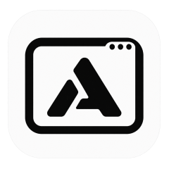
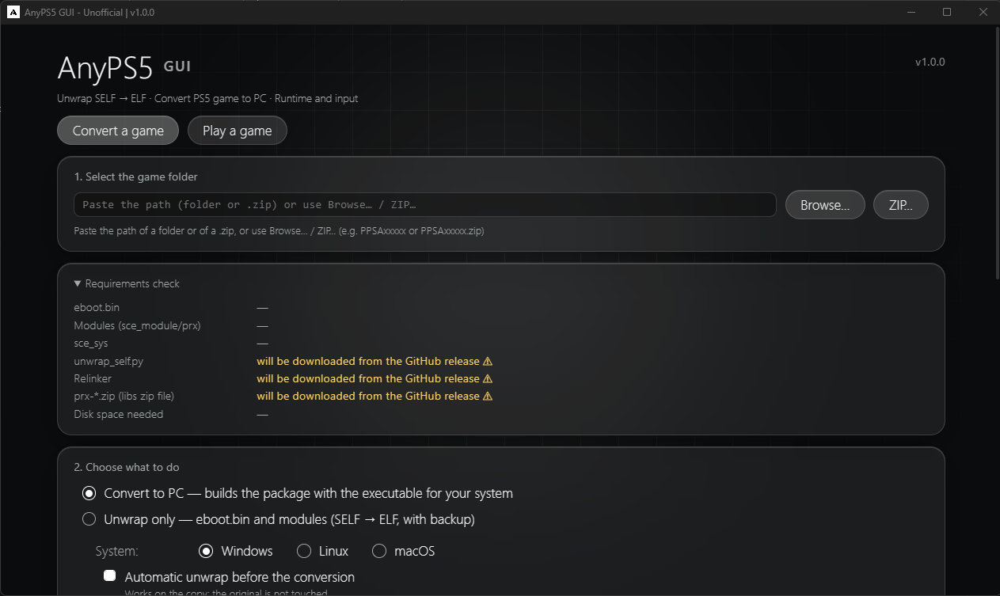
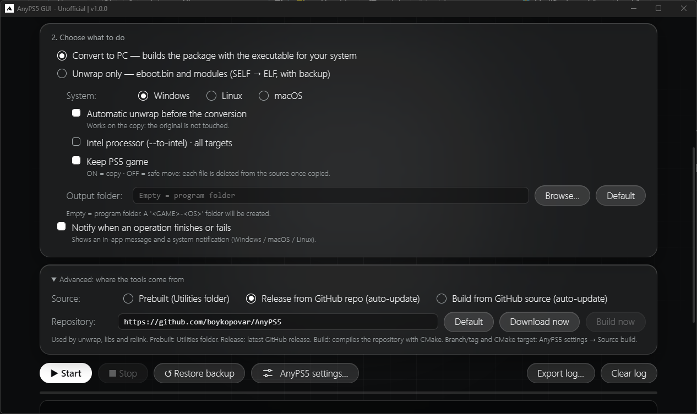
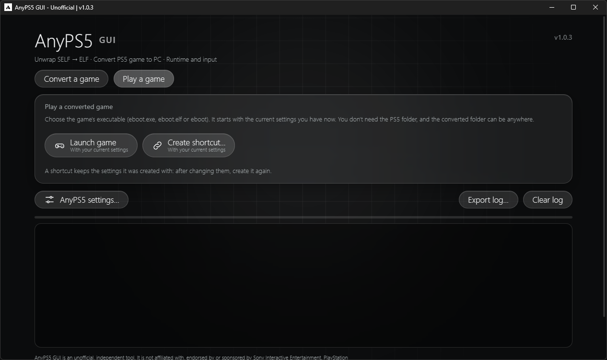
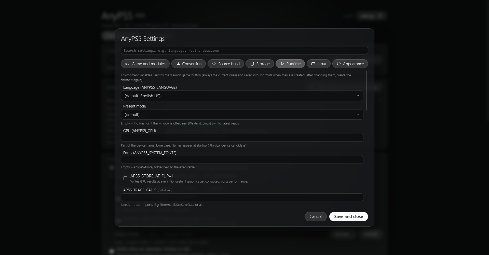
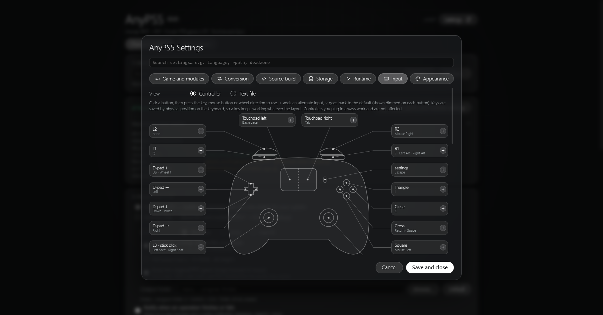
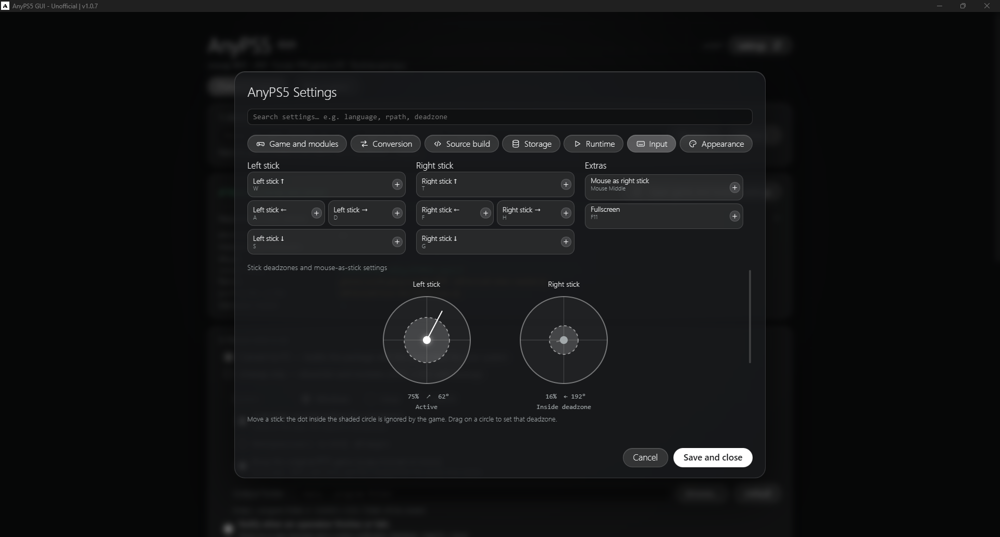
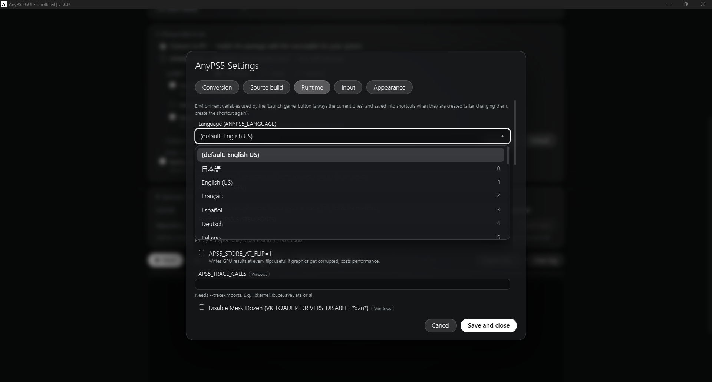
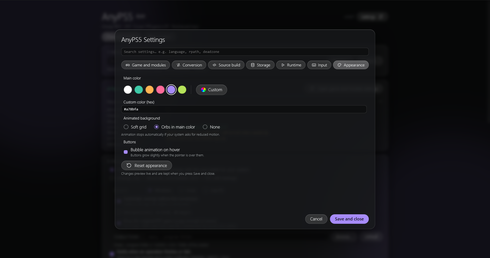

<p align="center">
  
</p>

<h1 align="center">AnyPS5 GUI</h1>

<p align="center">
  <strong>Dump → Unwrap → Relink → Play.</strong><br>
  <br>
  A graphical interface for <a href="https://github.com/boykopovar/AnyPS5">AnyPS5</a>.<br>
  Unwrap, convert (relink) and launch your own PS5 game dumps on PC — without the command line.
</p>

<p align="center">
  <a href="https://github.com/Lenny4250gh/AnyPS5-GUI/releases/latest"></a>
  <a href="https://github.com/Lenny4250gh/AnyPS5-GUI/releases"></a>
  <a href="LICENSE"></a>
  <a href="https://github.com/Lenny4250gh/AnyPS5-GUI/actions/workflows/build.yml"></a>
</p>

<p align="center">
  <a href="#download">Download</a> ·
  <a href="#quick-start">Quick start</a> ·
  <a href="#what-is-this-for">About</a> ·
  <a href="#highlights">Highlights</a> ·
  <a href="#feature-guide">Feature guide</a> ·
  <a href="#installation--requirements">Installation</a> ·
  <a href="#advanced-forks-and-custom-builds">Advanced</a> ·
  <a href="#build-from-source">Build</a> ·
  <a href="#support">Support</a>
</p>

> [!WARNING]
> **Unofficial.** Not affiliated with Sony or with the AnyPS5 project. This tool contains **no games, no firmware, no keys and no decryption**. Use it only on software you legitimately own (your own dumps or homebrew).

---

## Table of contents

| Section | What you will find |
|:--|:--|
| [Download](#download) | Builds for Windows, Linux and macOS |
| [Quick start](#quick-start) | From dump to launch in 5 steps |
| [What is this for?](#what-is-this-for) | What the GUI does and the typical flow |
| [Highlights](#highlights) | The best features at a glance |
| [Feature guide](#feature-guide) | Every page and setting, in detail |
| [Where the tools come from](#where-the-tools-come-from) | Local files, GitHub release or build from source |
| [Installation & requirements](#installation--requirements) | Verifying, folders, portable mode, upgrading, warnings |
| [Advanced: forks and custom builds](#advanced-forks-and-custom-builds) | Use any repository, branch or tag |
| [Build from source](#build-from-source) | Run or package the GUI yourself |
| [Support](#support) | Where to ask for help |
| [License, credits, disclaimer](#license) | Legal information |

---

## Download

<p align="center">
  <a href="https://github.com/Lenny4250gh/AnyPS5-GUI/releases/latest/download/AnyPS5_GUI-windows.exe"></a>&nbsp;&nbsp;
  <a href="https://github.com/Lenny4250gh/AnyPS5-GUI/releases/latest/download/AnyPS5_GUI-linux"></a>&nbsp;&nbsp;
  <a href="https://github.com/Lenny4250gh/AnyPS5-GUI/releases/latest/download/AnyPS5_GUI-macos.zip"></a>
</p>

<p align="center">
  <strong>Choose your operating system on the latest release page.</strong><br>
  Ready-to-run builds are provided for Windows, Linux and macOS. You do not need to install Python or compile the app.
</p>

| Operating system | What to download | After downloading |
|:--|:--|:--|
| **Windows** | The Windows executable (`.exe`) | Run the downloaded file. Windows may show a SmartScreen warning because the app is not code-signed. |
| **Linux** | `AnyPS5_GUI-linux` | Make it executable with `chmod +x AnyPS5_GUI-linux`, then run it. |
| **macOS** | The macOS archive (`.zip`) | Extract it and open the app. The first launch may require right-click → **Open** because it is not signed. |

<p align="center">
  <a href="https://github.com/Lenny4250gh/AnyPS5-GUI/releases"><strong>Browse all versions and release notes →</strong></a>
</p>

> [!TIP]
> The release page contains the detailed changelog for each version. This README is the stable guide to downloading, installing and using AnyPS5 GUI.

Need checksums, folders or portable mode? See [Installation & requirements](#installation--requirements).

---

## Quick start

1. **Open the app** and go to **Convert a game**.
2. **Check the requirements.** The app tells you what is missing (tools, CPU, GPU, memory) and can download the tools for you. On the first run it already picks the system, `--to-intel` and `--to-rosetta` options that fit your computer.
3. **Pick your game folder** (your own dump), or a `.zip` / `.rar` of it: archives are extracted automatically.
4. **Run Unwrap** if your files are decrypted SELF/fSELF, **then Relink**. The result is a `<GAME>-<system>` package in your output folder (by default a `Converted games` folder next to the program; change it in the settings).
5. **Go to Play a game** and press **Launch**, or create a shortcut.

Settings (runtime, input, appearance) can be changed at any time from their tabs.

---

## What is this for?

[AnyPS5](https://github.com/boykopovar/AnyPS5) is a command-line project that takes a **PS5 game dump you own** and turns it into a program that runs natively on a PC (Windows, Linux or macOS). It does this in a few separate steps, each with its own tool and its own options: unwrapping the executables, converting (relinking) them against replacement system libraries, and launching the result with the right environment variables.

**AnyPS5 GUI** puts all of that behind a normal window:

| | |
|:--|:--|
| **No command line** | You pick a folder, press a button, read the log. |
| **Everything in one place** | The tools (relinker, system libs, `unwrap_self.py`) are downloaded or built for you, kept up to date and checked before every run. |
| **Safe defaults, explained options** | Every relinker option has a short description and is automatically disabled when it does not fit the selected target (e.g. Windows-only flags). |
| **From dump to launch** | After converting, the same app launches the game, creates a shortcut and edits the controller mapping. |

### The typical flow

```
game dump (folder / .zip / .rar)
        │  Unwrap   (SELF/fSELF → ELF, with backup)
        ▼
   Relink  ──►  <GAME>-<system>/   (app0 + libs + executable)
        │
        ▼
   Launch / shortcut   (runtime settings + input mapping)
```

> [!NOTE]
> The GUI does **not** do the conversion itself: it drives the official AnyPS5 tools and shows what they do.

---

## Highlights

What you get besides "a window instead of a command line":

### Control

-  **Interactive input editor.** Click a button on the controller, press a key, mouse button or wheel direction, done. Alternate inputs, stick deadzones, mouse-as-stick (sensitivity, curve, smoothing, decay), and the new Stick modifier/scale are all in the same screen. Prefer text? Edit `anyps5-input.ini` directly, with a validity check.
-  **Options that make sense.** Every relinker option is explained and disabled automatically when it does not fit the selected target.
-  **Runtime settings and shortcuts.** GPU, language, present mode, fonts, tracing and more, passed to the game as environment variables, or saved in a shortcut.
-  **Share your settings as a file.** Export any section (conversion, runtime, input) as a small file and import someone else's. Handy to help a friend, or to post a working setup for a game.

### Tools and repositories

-  **Use any repository, not only the official one.** Point the GUI at a fork, a branch or an older tag and it downloads that release or builds it from source. Each repository gets its own folder, so testing a fork never mixes files with the official one. See [Advanced: forks and custom builds](#advanced-forks-and-custom-builds).
-  **Tools handled for you.** Relinker, system libs and `unwrap_self.py` are downloaded (checked with SHA-256) or built, and kept up to date.
-  **Self-updating.** The app checks this repository's latest release and can replace itself and restart.
-  **Asks before rebuilding.** When the repository has new commits and you already have a build, a popup shows the changes (commit titles and a link to GitHub) and lets you update and rebuild or keep your build.
-  **Faster, clearer builds.** Nothing is downloaded or built when the remote commit is the one you already have; builds show a progress bar with elapsed and remaining time, use Ninja and a compiler cache (ccache/sccache) when installed, and clone with parallel jobs.

### Safety and diagnostics

-  **Safe unwrap.** Original files are backed up, with a *Restore backup* button.
-  **Checks your computer.** The requirements list also tells you if your CPU (AVX2 and the other extensions AnyPS5 needs, Intel/AMD/Apple silicon), your GPU (Vulkan, software renderers, several GPUs) or, on Windows, your memory and page file are likely to cause trouble.
-  **One-click test report.** *Export report…* saves a file with your system info, runtime variables, exit code, an automatic reading of the log and the full log, ready to attach to a Discord message or a GitHub issue.
-  **Report or suggest.** A button in the top bar opens the GitHub issues of this project with your app version and system already filled in.

### Comfort

-  **Sound effects.** Short clicks and chimes, made by the app, with a volume slider (you can turn them off).

---

## Feature guide

Everything the app can do, organized by page.

| Page | Jump to |
|:--|:--|
| Convert a game | [Convert](#convert-a-game) · [Patches & fixed-base](#conversion-patches-and-fixed-base-options) |
| Play a game | [Play](#play-a-game) · [Game data & screenshots](#converted-game-data-and-screenshots) |
| Settings | [Settings](#settings) · [Runtime diagnostics & overlay](#runtime-diagnostics-and-overlay) |
| Input | [Input](#input) |
| Reports | [Test report](#test-report) |
| Updates | [Updates](#updates) |
| Look & integration | [Appearance](#appearance) · [Discord Rich Presence](#discord-rich-presence) |

### Convert a game

#### Steps

| Feature | Description |
|:--|:--|
| **Unwrap** | Already-decrypted SELF/fSELF → ELF, using the official `unwrap_self.py` (the original files are backed up, with a *Restore backup* button). |
| **Relink** | Builds the `<GAME>-<system>` package (app0 + libs + executable) for Windows, Linux or macOS. |
| **Output folder** | Converted games go to the output folder you choose in the settings. When it is empty, the default is a `Converted games` folder next to the program, created automatically. |
| **Game archives** | The game can be a folder or a `.zip` / `.rar` (`.rar` needs 7-Zip installed). |
| **First-run defaults** | Without a config file, the system is set to your own, `--to-intel` is on for Intel CPUs and `--to-rosetta` is on for Apple silicon. |
| **Rosetta** | The *Apple silicon via Rosetta (--to-rosetta)* option sits under the system choice and is hidden when the Windows system is selected. |
| **Tools source** | Choose where the relinker, libs and `unwrap_self.py` come from (see [Where the tools come from](#where-the-tools-come-from)). |

#### Options and arguments

| Feature | Description |
|:--|:--|
| **Options** | All relinker options, each marked with the systems it applies to. Options that do not fit the selected target are disabled automatically. |
| **Extra arguments** | A free-text field to pass options of newer relinker versions that the GUI does not know yet (split like a shell command line). An option already set by the GUI is refused. |
| **Relinker version** | The *Relinker version* button runs `relinker --version`. After each conversion the version used, the source (release tag or commit), the repository and the target are saved in `conversion_info.json` inside the package (useful for support). |
| **Audit** | Runs `import_audit.py` (if present) after the relink and logs a one-line summary: how many imports are implemented, stubbed (load but throw when called) or absent (the game will not load), plus the first absent names. |

#### Requirements check

Shows what is missing before you start, and downloads the tools for you when needed. It also checks:

| Check | What it looks at |
|:--|:--|
| **CPU** | x86-64 with AVX2, FMA, F16C, BMI1/2, LZCNT and MOVBE. Apple silicon is reported (use the macOS system with `--to-rosetta`) and Intel CPUs are reminded to turn on `--to-intel`. |
| **GPU** | Detected through Vulkan. Warns about software renderers (very slow), a missing Vulkan loader on Linux, several GPUs (choose one with `ANYPS5_GPU`) or an `ANYPS5_GPU` value that matches nothing. |
| **Memory (Windows)** | Free commit (RAM + page file) against the direct memory a title can commit. |
| **NVIDIA driver** | Reads the driver version and warns about versions known to crash (currently 610.47, crash in `nvgpucomp64.dll`). |
| **`/dev/udmabuf` (Linux)** | Tells you if it is missing or not accessible and how to fix it (only needed with Mesa drivers, not with the proprietary NVIDIA driver). |

<p align="center">
  <br>
  
</p>

### Conversion patches and fixed-base options

- **`--patches`** accepts a patch file. If no explicit file is supplied, the relinker may use `relinker-patches.toml` next to `eboot.bin` when present.
- **Verify patches** checks the selected patch file against the selected unwrapped game executable without writing changes.
- **`--no-patches`** explicitly disables patches and conflicts with `--patches`.
- **`--linux-fixed-base`** and **`--macos-fixed-base`** are now exposed for their respective targets, alongside the existing Windows fixed-base option. Values are validated for address format, alignment and target compatibility; Linux fixed-base also conflicts with `--lazy-binding`.

### Play a game

- **Launch** a converted game with your current settings, or **create a shortcut** that starts it with the right variables. The shortcut is named after the real game title read from the game's `param.json` (e.g. *Dreaming Sarah* instead of `PPSA02929`); if the title can't be read, the folder name is used.
- **Browse PC game…** opens the folder picker directly in your output folder, where your converted games are.
- **Exit code explained:** when the game ends, the log shows its exit code in plain words (missing library, segmentation fault, access violation, timeout…).
- **Check before start:** before launching, the app checks the package (executable, `app0`, `sce_sys/param.json`, original `.prx` files in `libs/` on Windows) and shows a plain message instead of a cryptic start-up error. On Linux/macOS it restores the execute permission lost after a zip or a download.
- **Launch protection (Windows):** if the MinGW runtime DLLs are missing from `libs/`, the game is not started and you get a clear message instead of error 126 on every library.

<p align="center">
  
</p>

### Converted game data and screenshots

- **Converted package path.** The **Play** view has a separate path for the converted PC game package, independent from the PS5 source path used for conversion. Launch and shortcut creation use the selected converted package; when no path is selected, the app attempts the configured output folder (`Converted games` by default).
- **Game folders (saves and trophies)** lets you open `_sd`, `_sd_mem` and `_trophy`. Save-data folders can be backed up as ZIP files; trophy data can be reset after a confirmation prompt. These actions operate on the selected/last-launched package, so check the displayed package path first.
- **Trophies:** after a run, the app counts the unlocked trophies in `_trophy` (PS5 and PS4 formats) and warns about damaged files, because the game stops when it reads one.
- **Screenshots:** the runtime `ANYPS5_SCREENSHOTS` setting accepts an absolute folder. When empty, screenshots go to `anyps5-screenshots/` next to the game executable. The **Screenshot gallery** in the Play view shows the latest ones (click to open) and has a button for the folder; the folder may not exist until the first F12 screenshot.
- **Shader cache:** Runtime settings show the effective AnyPS5 shader-cache path and current size, allow a custom absolute path through `ANYPS5_SHADER_CACHE_DIR`, and provide a clear-cache action. Clearing removes the AnyPS5 cache at that configured path, not the graphics driver's cache. `ANYPS5_NO_SHADER_CACHE` disables the on-disk cache; shaders may need to be rebuilt on later runs.

### Settings

- **Sections:** Game and modules, Conversion, Source build.
- **Runtime settings:** Language, GPU, present mode, fonts, tracing and more, passed to the game as environment variables.
- **`ANYPS5_GPU`** suggests the GPUs detected on your computer.
- **Storage:** see where the app keeps its tools, builds, backups and `config.ini`, and move everything to another folder with one click.
- **Export:** any section of the settings can be exported as a shareable file.

<p align="center">
  
</p>

### Runtime diagnostics and overlay

- **Performance overlay:** can be enabled from the first frame and positioned in any corner. In-game **F10** toggles its visibility.
- **New runtime settings** (a variable is set only when you change it from the default):

  | Setting | Variable | Notes |
  |:--|:--|:--|
  | Controller vibration | `ANYPS5_RUMBLE` | 0–100 % |
  | Controller speaker gain | `APS5_PAD_SPEAKER_FALLBACK_DB` | 0 to −60 dB or mute |
  | Log file | `ANYPS5_LOG_FILE` | Absolute path |
  | Host game mode | `APS5_GAME_MODE` | Feral GameMode on Linux, activity on macOS; not used on Windows |
  | Host report | `ANYPS5_HOST_REPORT=1` | OS, CPU, GPU, driver and Vulkan support printed once at start; ON by default and used by *Copy for bug* |

- **PlayGo:** `APS5_PLAYGO_UNLISTED_CHUNKS` can be set to `installed` or `absent` to control how unlisted PlayGo chunks are treated.
- **Test diagnostics (for bug reports)** enables extra profiling/log timestamp variables and, on Windows, crash indirect-memory diagnostics. It can slow the game slightly, so leave it off for performance comparisons.
- **Automatic log interpretation** now calls out host-import memory-budget and texture-cache diagnostics, with notes about the corresponding tuning variables.

### Input

- **Visual controller editor:** click a button, then press a key, mouse button or wheel direction. Alternate inputs supported.

  

- **Stick deadzones and mouse-as-stick settings** (sensitivity, curve, smoothing, decay).

  

- **Import / export** your settings, or edit `anyps5-input.ini` directly in text view (with validity check).

  

### Test report

- **Export report…** (below the log) saves a text file with the points of `GAME_TESTING.md`: GUI build, title ID and content version, CPU, OS, GPU, power source, system, runtime variables, `--to-intel`, how far the game got, exit code and presents per 10 s. It also contains the full log (the title's own `anyps5.log` / `run.log` when present) and an automatic reading of it (software renderer, stalled title, device lost, GPU out of memory, missing permissions). Measured data and the automatic reading are kept apart. Fields the GUI cannot know are left as *(fill in)*. Known errors (NVIDIA driver crash, `/dev/udmabuf`, out of memory, error 126/193, lost execute permission, duplicate output names) are explained with what to do.
- **Copy for bug** copies a short report (versions, host report, last 60 log lines) to paste in a GitHub issue.
- **Debug package…** saves a zip with the bug report, the full report, your settings and the `.registry.json` files.
-  In both, user name, computer name and home folder are hidden: **check the content before you share it.**
- **Report or suggest** (top bar) opens the GitHub issues of this project: report a bug (a form with your app version and system filled in), suggest something, or see the open issues. You need a GitHub account to post, and nothing else is sent.

### Updates

- **The app itself:** it checks the latest release of this repository and, when a newer one exists, can download it for your system, replace itself and restart.
- **New version of the tools repository:** with *Build from GitHub source*, the app compares the remote commit with the one you built (no download needed). If it is the same, nothing is fetched or built. If it is newer, a popup shows the date, the latest commit titles and a link to all the changes on GitHub; choose *Update and rebuild* or *Keep this build*. *Do not show this message again* saves your choice (see *Ask before updating and rebuilding* in [Advanced](#settings-reference)).

### Appearance

- **Main color** (presets or custom hex) and **animated background** (soft grid, orbs or none). It stops automatically if your system asks for reduced motion.
- **Sound effects:** short sounds generated by the app (no audio files) for buttons, tabs, dialogs, success and errors. Turn them off or change the volume in Appearance. They play only while the window has focus.

<p align="center">
  
</p>

### Discord Rich Presence

While the app is open it shows *In the launcher* and, during a conversion, the current phase (Preparing, Copying game files, Copying libs, Relinking…). It does not show which game you play. Turn it off with *Disable Discord Rich Presence* in the Appearance settings.

---

## Where the tools come from

The relinker, libs and `unwrap_self.py` are chosen in **Advanced: where the tools come from** (Convert a game page):

| Source | What it does |
|:--|:--|
| **Local files (manual)** | Uses the files you provide. Press **Import files…** and pick `unwrap_self.py`, `relinker-*` and `prx-*.zip` (optionally `nid_patcher`, `anyps5-input.ini`, fonts `.ttf`/`.otf`/`.ttc`, `import_audit.py` and `pad_input.py`): they are copied into the app folder (see [Installation](#installation--requirements)). If a file already exists you are asked whether to replace it. |
| **Release from GitHub repo (auto-update)** | Downloads the latest release (or a tag you choose) of a GitHub repository (**Download now**). The web input mapper (`tools/input-mapper`) is not a release file, so it is downloaded from the source of the same tag the first time you open it. |
| **Build from GitHub source (auto-update)** | Clones the repository and builds it (**Build now**); needs git, CMake and a C/C++ compiler. |

**Download now** and **Build now** are disabled while an operation runs; the **Stop** button next to them cancels it. Only the controls that apply to the selected source are shown. By default both GitHub sources point to the official [AnyPS5](https://github.com/boykopovar/AnyPS5) repository, but the repository is just a setting: see [Advanced](#advanced-forks-and-custom-builds).

---

## Installation & requirements

### Install

1. Open the [**Releases**](https://github.com/Lenny4250gh/AnyPS5-GUI/releases/latest) page.
2. Download the file for your system:

   | System | File |
   |:--|:--|
   | Windows | `AnyPS5_GUI-windows.exe` |
   | Linux | `AnyPS5_GUI-linux` (then `chmod +x AnyPS5_GUI-linux`) |
   | macOS | `AnyPS5_GUI-macos.zip` |

3. *(Optional but recommended)* **verify the file**: compare its SHA-256 with the `sha256:` value GitHub shows next to each file on the release page:
   - Windows (PowerShell): `Get-FileHash .\AnyPS5_GUI-windows.exe -Algorithm SHA256`
   - Linux: `sha256sum AnyPS5_GUI-linux`
   - macOS: `shasum -a 256 AnyPS5_GUI-macos.zip`
4. **Run it.** The first time it creates an `AnyPS5_GUI` folder in your user data folder (so it survives updates), where it keeps the downloaded tools (relinker, libs, `unwrap_self.py`), `config.ini`, backups and so on. You can move it from **Settings → Storage**. To keep everything next to the program instead, put an empty file named `portable` next to it (in that mode the folder is called `Utilities/`).

   | System | Default app folder |
   |:--|:--|
   | Windows | `%APPDATA%\AnyPS5_GUI` (Roaming) |
   | macOS | `~/Library/Application Support/AnyPS5_GUI` |
   | Linux | `~/.local/share/AnyPS5_GUI` |

> [!NOTE]
> All three files are built automatically by GitHub Actions on real Windows, macOS and Linux machines, straight from the source in this repository. You can inspect the [workflow](.github/workflows/build.yml) and the [build runs](https://github.com/Lenny4250gh/AnyPS5-GUI/actions).

### Requirements and warnings

| System | What to know |
|:--|:--|
| **Windows** | Needs the Microsoft Edge WebView2 runtime (already present on up-to-date Windows 10/11). SmartScreen or your antivirus may warn about the file: it is not code-signed, and PyInstaller one-file programs are often flagged as false positives. If you don't trust the binary, read the source and [build it yourself](#build-from-source) (it takes a minute). |
| **macOS** | The app is not signed. Right-click the app → **Open** the first time (or run `xattr -cr AnyPS5_GUI.app`). |
| **Linux** | The binary bundles Qt, but it still needs a few system libraries. On Debian/Ubuntu: `sudo apt install libegl1 libgl1 libxkbcommon-x11-0 libxcb-cursor0 libdbus-1-3`. |

### Release notes and version history

For the full notes of a specific version, open that version on the [GitHub Releases page](https://github.com/Lenny4250gh/AnyPS5-GUI/releases). This keeps long change lists on the release page instead of making the README harder to scan. Use this README for the current download, installation steps, requirements and documentation.

### Upgrading from an older version

The first versions kept a `Utilities/` folder next to the program. On startup the app moves it automatically to the new location (your user data folder, or the one chosen in **Settings → Storage**):

- Only what the app itself uses is moved: tools (`unwrap_self.py`, `relinker-*`, `prx-*.zip`, `tools/`), `config.ini`, `anyps5-input.ini`, backups, fonts and 7-Zip files.
- Items that already exist in the new folder are not overwritten, and any other file you left in the old folder stays where it is.
- The old folder is removed (sent to the trash) only if nothing else is left in it.
- The big folders `release/`, `source/`, `toolchain/`, `extracted/` and `update/` are moved only if the old and new folders are on the same drive; otherwise they stay behind and are downloaded or rebuilt when needed.

---

## Advanced: forks and custom builds

The **Repository URL** field is not tied to AnyPS5. You can point the GUI at a **fork** or at any repository that follows the same layout, and the app will download its releases or build it from source. This is useful to try a fork with extra fixes, a branch that is still in development, or an older version.

<a id="settings-reference"></a>

### Settings reference

| Setting | Used by | Meaning |
|:--|:--|:--|
| **Repository URL** | Release, Build | Accepts `https://github.com/owner/repo`, `github.com/owner/repo` or just `owner/repo`. Empty = the official AnyPS5 repository. The **Release** source only works with `github.com` URLs; the **Build** source also accepts any URL `git` can clone (`https`, `ssh`, `git`, `file`, `user@host:path`). |
| **Release tag** | Release | Empty = latest release. Set e.g. `v0.1.2` to pin a version. |
| **Check for a newer release before every run** | Release | ON = asks GitHub which release is current and downloads only the missing files. OFF = reuses what was already downloaded (works offline). |
| **Branch or tag** | Build | Empty = the repository's default branch. |
| **CMake target** | Build | Empty = tries the target `relinker` first and, if it does not exist, builds everything. Also used as the name of the executable to pick up. |
| **Extra CMake arguments** | Build | Added to the configure step, e.g. `-G Ninja -DCMAKE_CXX_COMPILER=clang++`. Without your own choice, the GUI adds the Ninja generator (Linux/macOS, if `ninja` is installed) and a compiler cache (`ccache` or `sccache`, if installed). |
| **Check for updates before every relink** | Build | ON = checks the latest commit and rebuilds only if it changed. OFF = reuses the existing build. |
| **Ask before updating and rebuilding** | Build | ON (default) = when a build already exists and the repository is newer, a popup asks whether to update or keep the build. OFF = no question: it follows *Check for updates before every relink*. |
| **Extra arguments (passed as they are)** | Conversion | Relinker options the GUI does not know yet, e.g. `--new-option 1`. Quotes allowed. An option already set by the GUI is refused. |
| **Build the libs (.prx) from the repository** | Build | ON = also builds the `libs` target and uses those libs instead of a `prx-*.zip`. Much slower (full CMake configuration, downloads FFmpeg, needs the SDL/Vulkan build dependencies). |
| **Build jobs (parallel compilers)** | Build | Empty = automatic: about half of your CPU threads, more if you have a lot of RAM. A higher number (e.g. 12 or 16 on a 16-thread CPU) builds faster but uses more RAM; if the PC slows down or freezes, lower it. An interrupted build resumes where it stopped. |

### Folder layout

Each repository gets its own folder, so switching between the official repo and a fork does not mix files:

```
AnyPS5_GUI/              (the app folder)
├── release/<repo>/<tag>/    files downloaded from a GitHub release
├── source/<repo>-<hash>/    clone + CMake build of a repository
└── ...                      files imported manually (Local source)
```

### What a repository must contain

<details open>
<summary><strong>For the Release source</strong></summary>

<br>

The GUI asks the GitHub API for the release (`latest`, or the tag you set) and looks at its **assets** by name. Names are matched case-insensitively:

| Asset | Required | Rules |
|:--|:-:|:--|
| `relinker-*` | yes | The relinker executable **for the OS the GUI runs on**. On Windows it must end in `.exe`; on Linux/macOS it must have no extension (so `relinker-v0.1.2` is fine, `relinker-v0.1.2.zip` or `.md`, `.txt`, `.json`, `.sha256`… are ignored). If several match, the last one in alphabetical order (the newest version) is used. |
| `prx-*.zip` | yes | The system libs. The zip must contain a folder named `libs` or `libs-<system>` (`libs-windows`, `libs-linux`, `libs-macos`; the system-specific one is preferred). The zip is read as it is, no need to extract it. If the name contains `windows` or `linux` the right one is chosen for the selected target (**macOS uses the `linux` zip**); otherwise any `prx-*.zip` is used. |
| `USAGE.md`, `INPUT_MAPPING.md`, `release-notes.md` | no | Small documentation files, downloaded if present. |
| `unwrap_self.py` | no (see below) | Not read from the assets. |

`unwrap_self.py` is **not** a release asset: it is downloaded from `tools/unwrap_self.py` **at the same tag** of the repository. If that tag does not contain it, the GUI falls back to the default branch (and warns you); if it is not there either, it falls back to the copy in the app folder.

Downloads are verified against the SHA-256 that GitHub publishes for each asset. If GitHub cannot be reached, the release already downloaded is reused. GitHub allows about 60 API requests per hour without a token: set the `GITHUB_TOKEN` (or `GH_TOKEN`) environment variable to raise the limit.

Minimal example of a compatible release:

```
v1.2.3
├── relinker-v1.2.3.exe        (Windows build of the relinker)
├── relinker-v1.2.3            (Linux/macOS build, no extension)
├── prx-windows-v1.2.3.zip     (contains libs/ or libs-windows/)
├── prx-linux-v1.2.3.zip       (contains libs/ or libs-linux/)
└── USAGE.md                   (optional)
```

and, in the repository at the same tag: `tools/unwrap_self.py`.

</details>

<details open>
<summary><strong>For the Build from source option</strong></summary>

<br>

The GUI runs a shallow `git clone --recurse-submodules --depth 1` (without tags, with parallel jobs) (adding `--branch <ref>` if you set one), then CMake in `Release` mode. Your repository needs:

- A **`CMakeLists.txt` in the root**. Without it the build stops with an error.
- A CMake target that produces the relinker executable, by default named **`relinker`** (or set your own in *CMake target*). The GUI finds the built executable by looking for a file whose name contains the target name. If the target does not exist and you did not set one, it builds everything and searches again.
- Support for the CMake option **`-DANYPS5_RELINKER_ONLY=ON`**, which the GUI passes automatically so the relinker is built without SDL, Vulkan and FFmpeg. (If you pass your own `-DANYPS5_RELINKER_ONLY=…` in the extra arguments, yours wins.)
- The AnyPS5 folder layout: the folders `core/`, `3rdparty/`, `cmake/` and `tools/` are expected. A missing one is only a warning, but a very different layout probably will not work.
- **`tools/unwrap_self.py`**, used for the Unwrap step (the cloned copy replaces the one in the app folder).
- Optional: `tools/pad_input.py` (controller helper) and `tools/import_audit.py` (audit after relink), picked up from the clone if present.

If you also enable **Build the libs from the repository**, the repo must have a CMake target **`libs`** whose output goes to `<build>/core/libs/libs/*.prx`. Only the `.prx` files that match the folder names under `core/libs/prx/` are kept, the same selection as the official `tools/package_release.py`.

The build is remembered by **commit and target**: the GUI reads the remote commit without downloading anything, and if it did not change and you did not change the target or the build settings, the existing relinker is reused and nothing is fetched or rebuilt. The build log shows a progress bar with elapsed and remaining time, and the total time at the end.

**Tools needed to build.** `git`, `cmake` and a C/C++ compiler must be in your `PATH` (on Debian/Ubuntu: `sudo apt install git cmake build-essential`). On Windows the project supports only the MinGW-w64 GCC 15.2.0 (WinLibs, with Ninja) toolchain, and the GUI can install git, CMake and that toolchain for you with one click (the toolchain is about 270 MB, saved in `toolchain/` inside the app folder). Visual Studio cannot link this project.

**Paths with spaces.** The repository's CMake passes the `-include` path of the libs build to the compiler without quotes. When the folder path contains a space (e.g. `AnyPS5 GUI`), the GUI quotes it for you in its cloned copy before configuring. If you still get path errors, use a short folder without spaces (e.g. `C:\AnyPS5`).

</details>

### Quick checklist for a fork

1. **Fork** [AnyPS5](https://github.com/boykopovar/AnyPS5) and push your changes; don't rename `tools/unwrap_self.py`, the `relinker` target or the top-level folders.
2. **To test from source:** in the GUI choose *Build from GitHub source*, enter `your-name/AnyPS5` as the repository, optionally a branch in *Branch or tag*, then press **Build now**.
3. **To distribute a version:** create a GitHub release and attach `relinker-<version>[.exe]` and `prx-<system>-<version>.zip` files named as in the tables above. Anyone can then choose *Release from GitHub repo*, enter your repository and get it.
4. **Switching back** to the official repository is just a matter of clearing the field.

> [!CAUTION]
> Only point the GUI at repositories you trust: both options download and then **run** code (the relinker, and `unwrap_self.py`) from that repository on your computer.

---

## Build from source

Requires Python 3.9+ (3.11 is what the CI uses).

```bash
git clone https://github.com/Lenny4250gh/AnyPS5-GUI.git
cd AnyPS5-GUI
pip install -r requirements.txt
python AnyPS5_GUI.py          # run directly
```

To build the executable you also need PyInstaller and Pillow:

```bash
pip install pyinstaller pillow
python build.py               # asks for the target OS
python build.py 3             # no questions: 1 = Windows, 2 = macOS, 3 = Linux
```

`build.py` embeds `index.html` into the executable and calls PyInstaller. PyInstaller cannot cross-compile: it always packages for the system it runs on, so build **on** the system you are targeting (or let GitHub Actions do it). The result is in `dist/`.

When running from source on Linux, pywebview needs a WebKitGTK or Qt backend, see the [pywebview docs](https://pywebview.flowrl.com/guide/installation.html).

---

## Support

| Problem with… | What to do |
|:--|:--|
| **This GUI** (it doesn't open, a button does nothing, a wrong option) | Use the **Report or suggest** button in the app, or open an [issue](https://github.com/Lenny4250gh/AnyPS5-GUI/issues). Please include your OS, the GUI version and any error shown, and paste **Copy for bug** or attach the file from **Export report…** / **Debug package…** if it is about a game. |
| **AnyPS5 itself** (a game doesn't start, crashes, missing library functions) | This GUI cannot fix them. Attach the report from **Export report…** and ask in the official [AnyPS5 Discord](https://discord.gg/BHFztBPUe) or in the [Game bring-up discussions](https://github.com/boykopovar/AnyPS5/discussions/categories/game-bring-up), and read the [usage guide](https://github.com/boykopovar/AnyPS5/blob/main/docs/user/USAGE.md). |

---

## License

GPL-2.0-only, see [LICENSE](LICENSE). The GUI loads the official `unwrap_self.py` from the AnyPS5 project (GPL v2 only) and does not contain a copy of it. If you redistribute it together with the GUI, include its license and sources.

## Credits

[AnyPS5](https://github.com/boykopovar/AnyPS5) by its authors, which does the real work (relinker, system libraries, `unwrap_self.py`). This GUI only makes it easier to use.

## Disclaimer

For interoperability, research, preservation and compatibility purposes only. This project does not include, distribute or require copyrighted software, firmware, cryptographic keys or proprietary libraries. You are responsible for obtaining and using any binaries in accordance with applicable laws and license terms. Provided "as is", without warranty.
