<p align="center">
  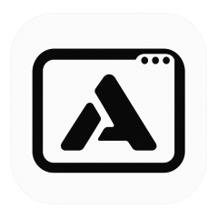
</p>

<h1 align="center">AnyPS5 GUI</h1>

<p align="center">
  <strong>Dump → Convert → Play on PC</strong><br>
  <br>
  Every <a href="https://github.com/boykopovar/AnyPS5">AnyPS5</a> option, one window away.<br>
  Unwrap, convert (relink) and launch your own PS5 game dumps on PC:<br>
  simple enough for beginners, flexible enough for power users.
</p>

<p align="center">
  <a href="https://github.com/Lenny4250gh/AnyPS5-GUI/releases/latest"></a>
  <a href="https://github.com/Lenny4250gh/AnyPS5-GUI/releases"></a>
  <a href="LICENSE"></a>
  <a href="https://github.com/Lenny4250gh/AnyPS5-GUI/actions/workflows/build.yml"></a>
</p>

<p align="center">
  <a href="#download">Download</a> ·
  <a href="#what-is-this-for">What is it?</a> ·
  <a href="#quick-start">Quick start</a> ·
  <a href="#using-the-app">Using the app</a> ·
  <a href="#where-the-tools-come-from">Tools</a> ·
  <a href="#installation--requirements">Installation</a> ·
  <a href="#advanced-forks-and-custom-builds">Advanced</a> ·
  <a href="#build-from-source">Build</a> ·
  <a href="#support">Support</a>
</p>

> [!WARNING]
> **Unofficial.** Not affiliated with Sony or with the AnyPS5 project. This tool contains **no games, no firmware, no keys and no decryption**. Use it only on software you legitimately own (your own dumps or homebrew).

> [!NOTE]
> **Built with AI assistance.** Most of the code was written with the help of AI tools ("vibe coding"). I test everything as thoroughly as I can (on Windows), but bugs are still possible. Please report them with the **Report or suggest** button or open an [issue](https://github.com/Lenny4250gh/AnyPS5-GUI/issues).

---

## Download

<p align="center">
  <a href="https://github.com/Lenny4250gh/AnyPS5-GUI/releases/latest/download/AnyPS5_GUI-windows.exe"></a>&nbsp;&nbsp;
  <a href="https://github.com/Lenny4250gh/AnyPS5-GUI/releases/latest/download/AnyPS5_GUI-linux"></a>&nbsp;&nbsp;
  <a href="https://github.com/Lenny4250gh/AnyPS5-GUI/releases/latest/download/AnyPS5_GUI-macos.zip"></a>
</p>

Ready-to-run builds are provided for Windows, Linux and macOS. You don't need to install Python or compile anything.

| Operating system | What to download | After downloading |
|:--|:--|:--|
| **Windows** | `AnyPS5_GUI-windows.exe` | Run it. Windows may show a SmartScreen warning because the app is not code-signed. |
| **Linux** | `AnyPS5_GUI-linux` | `chmod +x AnyPS5_GUI-linux`, then run it. |
| **macOS** | `AnyPS5_GUI-macos.zip` | Extract it and open the app. The first time, right-click → **Open** (it is not signed). |

The [release page](https://github.com/Lenny4250gh/AnyPS5-GUI/releases) has the changelog of every version. This README is the stable guide to installing and using the app. Checksums, folders and portable mode: see [Installation & requirements](#installation--requirements).

---

## What is this for?

[AnyPS5](https://github.com/boykopovar/AnyPS5) is a command-line project that takes a **PS5 game dump you own** and turns it into a program that runs natively on a PC (Windows, Linux or macOS). It works in separate steps, each with its own tool and options. **AnyPS5 GUI puts all of those steps, and all of their options, in one normal window.**

```
game dump (folder / .zip / .rar)
        │  Unwrap   (SELF/fSELF → ELF, with backup)
        ▼
   Relink  ──►  <GAME>-<system>/   (app0 + libs + executable)
        │
        ▼
   Launch / shortcut   (runtime settings + input mapping)
```

| | |
|:--|:--|
| **No command line** | Pick a folder, press a button, read the log. |
| **All of AnyPS5, not just the basics** | Every relinker option, runtime variable and input setting is available, each with a short explanation. Options that don't fit the selected target are disabled automatically. An *Extra arguments* field accepts options newer than the GUI. |
| **Tools handled for you** | The relinker, system libs and `unwrap_self.py` are downloaded (checked with SHA-256) or built, and kept up to date. |
| **From dump to launch** | The same app converts, launches the game, creates a shortcut and edits the controller mapping. |

> [!NOTE]
> The GUI does **not** do the conversion itself: it drives the official AnyPS5 tools and shows what they do.

**Who is it for?**

- **If you don't use the command line:** the app checks your PC, downloads the tools, picks sensible defaults for your system and explains every option in plain words.
- **If you do:** you keep full control and save time. Save a setup and reuse it, share it as a file, switch between the official repository, a fork, a branch or an older tag in a few clicks, and export a ready-to-post bug report. See [Advanced](#advanced-forks-and-custom-builds).

---

## Quick start

1. **Open the app.** You land on the **Library**, your games in one place.
2. **Add your folders** once with **Folders…**: the folder with your PS5 dumps and, optionally, where converted games live. The default output folder is always included.
3. **Check the requirements** on the **Convert** tab. If a tool is missing, the app can download it for you. On the first run it already picks the system, `--to-intel` and `--to-rosetta` settings that fit your computer.
4. **Convert a dump.** From the Library press **Convert** (or **Add to queue** / **Queue all** for several games). For a single game step by step, use the **Convert** tab (folder or `.zip` / `.rar`). The result is a `<GAME>-<system>` package in your output folder.
5. **Launch** it from the Library when the game shows as converted. Use **By path** only if the package is not listed.

Settings (runtime, input, appearance) can be changed at any time. To use a fork, branch or tag, see [Advanced](#advanced-forks-and-custom-builds).

---

## Using the app

The app has three main tabs: **Library** (home), **Convert** and **By path**. Three buttons in the top bar are always available: **Queue**, **Report or suggest** and **Settings**.

| Page | What it is for |
|:--|:--|
| [Library](#library) | Your dumps and converted games in one list: launch, convert, queue, delete |
| [Convert](#convert) | Convert or unwrap one game step by step |
| [Conversion queue](#conversion-queue) | Convert several games one after the other (side panel, any tab) |
| [By path](#by-path) | Launch a converted folder that is not in the Library |
| [Settings](#settings) | Runtime variables, input mapping, appearance, storage |
| [Reports and updates](#reports-and-updates) | Bug reports, log reading, self-update |

### Library

The home screen. One row (or card) per game: a dump and its converted package are matched by Title ID (without one, by folder name).

<p align="center">
  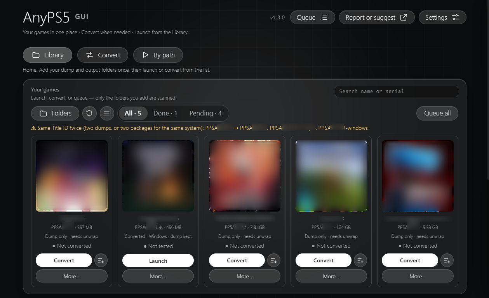
</p>

**Setting it up.** Add the folder with your dumps and the folder with your converted games from **Folders…**. The output folder is always included. Only those folders and their direct sub-folders are read: the whole disk is never scanned.

**Finding games.** Search by name or serial, filter with **All · n** | **Done · n** | **Pending · n**, switch between grid (default) and table view, and sort by clicking a column. Your choices are remembered, and changing the filter, view or sorting animates the rows. When the Library is empty or a filter shows nothing, the page offers direct actions (add folders, convert a game, open Queue, show all).

**Table view.** Columns: icon, name, serial (Title ID), game version, size (calculated in the background and cached; the refresh button recalculates it), state, path, *Converted with*, status (from the last run report) and your own comment. You can resize columns by dragging a header edge (double-click a handle to reset). The **Actions** column stays fixed on the right while the rest scrolls.

<p align="center">
  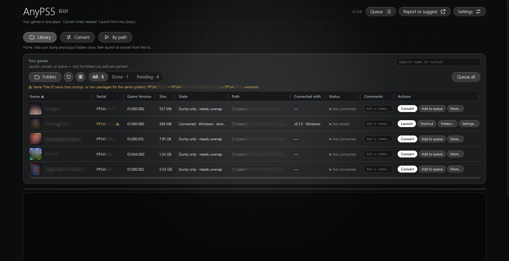
</p>

**What you can do with a game**

| Game state | Actions |
|:--|:--|
| **Dump, not converted** | **Convert** starts the conversion right away (one confirmation, none if it is the only game in the queue). **Add to queue** adds it to the [queue](#conversion-queue); once the queue has games it becomes the main button and turns into **Remove from queue** for games already in it. **Queue all** queues every dump without a package. |
| **Converted** | **Launch**, **Shortcut**, **Folders…** (package, `_sd`, `_sd_mem`, `_trophy`, screenshots, save backups, trophy reset) and **Settings…** (language, present mode, fullscreen, overlay, GPU, upscale, FPS limit and extra variables for that game only; its shortcut uses them too). If a game has packages for more than one system, a button switches between them. |
| **Any** | **More…** opens the details window, with **Delete PS5 dump…** and **Delete converted game…** (red buttons, each with an "Are you sure?" window; the folder is deleted for good, not sent to the recycle bin). Library folders and a running game are protected. |

**Live states.** While the app works on a game, its status shows what is happening: *In conversion queue*, *Converting…*, *Unwrapping…*, *Previewing conversion…*, *Restoring backup…*, *Launching…*, *Deleting…* A busy game cannot be launched, converted, queued or deleted until it finishes, and the Library refreshes by itself when a conversion ends. A warning appears if the same Title ID is found twice.

### Convert

Use this page to convert or unwrap **one** game step by step. (For several games use the [queue](#conversion-queue); for games already in the Library, use the Library.)

<p align="center">
  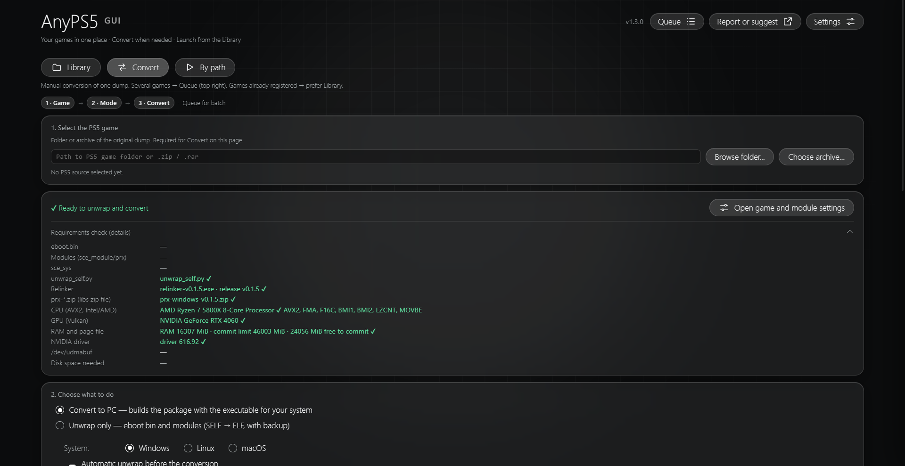
</p>

**1. Select the PS5 game.** A folder, or a `.zip` / `.rar` archive (`.rar` needs 7-Zip). Below it, the **requirements check** shows what is missing before you start:

| Check | What it looks at |
|:--|:--|
| **Tools** | `unwrap_self.py`, the relinker and the libs (`prx-*.zip`). Missing ones can be downloaded for you. |
| **CPU** | x86-64 with AVX2, FMA, F16C, BMI1/2, LZCNT and MOVBE. Apple silicon is reported (use the macOS system with `--to-rosetta`); Intel CPUs are reminded to turn on `--to-intel`. |
| **GPU** | Detected through Vulkan. Warns about software renderers (very slow), a missing Vulkan loader on Linux, several GPUs (choose one with `ANYPS5_GPU`) or an `ANYPS5_GPU` value that matches nothing. |
| **Memory (Windows)** | Free commit (RAM + page file) against the direct memory a title can commit. |
| **NVIDIA driver** | Warns about versions known to crash (currently 610.47, crash in `nvgpucomp64.dll`). |
| **`/dev/udmabuf` (Linux)** | Tells you if it is missing or not accessible and how to fix it (only needed with Mesa drivers, not with the proprietary NVIDIA driver). |

**2. Choose what to do.**

| Option | Description |
|:--|:--|
| **Convert to PC** | Builds the `<GAME>-<system>` package (app0 + libs + executable) for Windows, Linux or macOS. |
| **Unwrap only** | Already-decrypted SELF/fSELF → ELF, using the official `unwrap_self.py`. Originals are backed up. |
| **System** | The target: Windows, Linux or macOS. On the first run it is set to your own. |
| **Apple silicon via Rosetta** (`--to-rosetta`) | Under the system choice; hidden when Windows is selected. On by default on Apple silicon. |
| **Intel Mac without AVX2** (`--to-avx`) | macOS only, not combinable with Rosetta. Emulates AVX2 in software (slower). The requirements check tells you when your Mac needs it. |
| **Intel processor** (`--to-intel`) | On by default on Intel CPUs. |
| **Automatic unwrap** | Unwraps the copy of the game before converting; the original is not touched. |
| **Keep the original** | ON = copy the game. OFF = safe move: each file is deleted from the source once copied. |
| **Output folder** | Where converted games go. Empty = a `Converted games` folder next to the program, created automatically. |
| **Notifications / trash** | Notify when an operation ends or fails; open the trash folder when a failed or cancelled operation moves an incomplete folder there. |

All other relinker options live in **Settings → Conversion** (see [Conversion options](#conversion-options)).

**3. Start.**

<p align="center">
  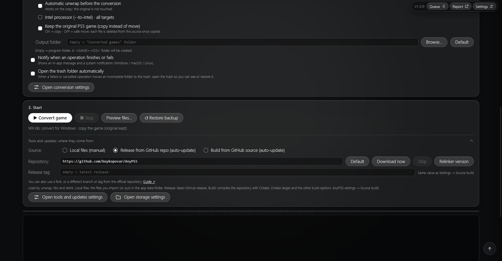
</p>

| Button | What it does |
|:--|:--|
| **Convert game** / **Stop** | Starts or cancels the operation. |
| **Preview files…** | Runs the converter in `--dry-run` mode and lists the files it would create, without writing anything. Needs an already unwrapped game. |
| **Restore backup** | Puts back the originals saved before an unwrap. |
| **Relinker version** | Runs `relinker --version`. After each conversion, the version, source (release tag or commit), repository and target are saved in `conversion_info.json` inside the package (useful for support). |

Under the buttons, **Tools and updates: where they come from** lets you choose where the relinker, libs and `unwrap_self.py` come from (see [Where the tools come from](#where-the-tools-come-from)). After a relink the app also runs `import_audit.py` (if present) and logs a one-line summary: how many imports are implemented, stubbed (load but throw when called) or absent (the game will not load), plus the first absent names.

#### Conversion options

All relinker options are in **Settings → Conversion**, each marked with the systems it applies to. Options that don't fit the selected target are disabled automatically, and so are those the relinker you use does not list in `relinker --help` (a fork or an older build): they are tagged *Not in this relinker*. If you convert with such an option on, the log says which one and stops before running. The **Extra arguments** field passes options the GUI does not know yet, split like a shell command line; an option already set by the GUI is refused.

Notable options:

- **`--patches`** takes a patch file. Without one, the relinker may use `relinker-patches.toml` next to `eboot.bin`. **Verify patches** checks a patch file against the unwrapped executable without writing anything. **`--no-patches`** disables patches and conflicts with `--patches`.
- **`--windows-fixed-base`**, **`--linux-fixed-base`**, **`--macos-fixed-base`**: values are validated for address format, alignment and target; Linux fixed-base also conflicts with `--lazy-binding`.
- **`--function-symbol-roots`** treats defined function symbols as code entry points instead of trusting `st_size` ranges (export validation, Windows/macOS analysis).
- **`--omit-unavailable-dependencies`** (Linux only) omits bundled-module dependencies that no converted module provides and that are not on `--rpath`. Use it only when the run path already holds every needed system library.

### Conversion queue

A side panel that slides in from the right, like a browser's download manager. Open it with the **Queue** button in the top bar (the badge shows how many games are in it); it works from every tab. **Esc** or a click outside closes it.

<p align="center">
  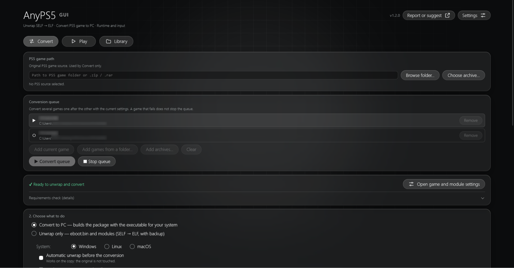
</p>

| Feature | Description |
|:--|:--|
| **Add games** | From the Library (**Add to queue**, **Queue all**, **Convert**), or from the panel: **Current game** (the one selected in Convert), **Folder…** (a game folder, or a folder with several games) and **Archives…** (`.zip` / `.rar`). Adding from the Library opens the panel automatically. |
| **Run** | **Convert queue** (or **Unwrap queue**) processes the games one after the other with the current Convert settings. One confirmation at the start. A failed game does not stop the others. The panel closes by itself and the log slides into view. |
| **Live progress** | A progress bar in the footer shows *Working on <game> · N%*. |
| **Icons** | Each row shows the game icon (grayscale while pending, full colour when done). |
| **Stop / Remove / Clear** | **Stop** cancels the rest. **Remove** and **Clear** take games out of the list (blocked while the queue runs). |

### By path

For a converted package that is **not** listed in the Library. Prefer the Library when the game is already registered.

<p align="center">
  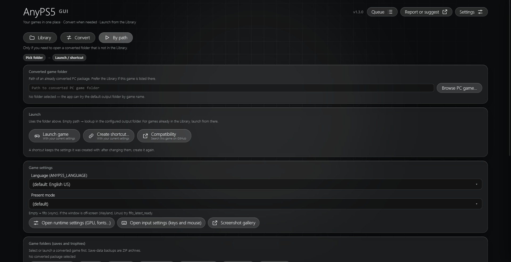
</p>

- **Converted game folder.** The path of the converted PC package (independent from the PS5 source path of the Convert page). If empty, the app tries the output folder using the game's name. **Browse PC game…** opens the picker directly in your output folder.
- **Launch game** starts it with your current settings. **Create shortcut…** makes a shortcut that starts it with the right variables, named after the real title from the game's `param.json` (e.g. *Dreaming Sarah* instead of `PPSA02929`; if the title can't be read, the folder name is used). A shortcut keeps the settings it was created with: after changing them, create it again.
- **Compatibility** opens the AnyPS5 [Game bring-up](https://github.com/boykopovar/AnyPS5/discussions/categories/game-bring-up) discussions, already searching the Title ID.
- **Check before start.** The app verifies the package (executable, `app0`, `sce_sys/param.json`, and `.prx` files in `libs/`: original PS5 modules or libs of another system are refused, while AnyPS5's own Windows libs, which are DLLs named `.prx`, are accepted) and shows a plain message instead of a cryptic start-up error. On Linux/macOS it restores the execute permission lost after a zip or a download. On Windows, if the MinGW runtime DLLs are missing from `libs/`, the game is not started and you get a clear message instead of error 126 on every library.
- **Exit code explained.** When the game ends, the log shows its exit code in plain words (missing library, segmentation fault, access violation, timeout…), a [run report summary](#reports-and-updates) and the number of unlocked trophies.
- **Game folders (saves and trophies).** Opens `_sd`, `_sd_mem` and `_trophy`. Save-data folders can be backed up as ZIP files; trophy data can be reset after a confirmation. After a run, damaged trophy files are reported (the game stops when it reads one). These actions use the selected or last-launched package, so check the displayed path first.
- **Screenshots.** The runtime `ANYPS5_SCREENSHOTS` setting accepts an absolute folder; when empty, screenshots go to `anyps5-screenshots/` next to the game executable. The **Screenshot gallery** shows the latest ones (click to open). The folder may not exist until the first F12 screenshot.
- **Shader cache.** Runtime settings show the AnyPS5 shader-cache path and size, allow a custom absolute path (`ANYPS5_SHADER_CACHE_DIR`) and have a clear-cache action (this clears the AnyPS5 cache, not the graphics driver's). `ANYPS5_NO_SHADER_CACHE` disables the on-disk cache; shaders may then need to be rebuilt on later runs.

### Settings

Open **Settings** (top bar, or Ctrl+K to search every setting). Sections: **Game and modules**, **Conversion**, **Source build**, **Storage**, **Runtime**, **Input**, **Appearance**.

<p align="center">
  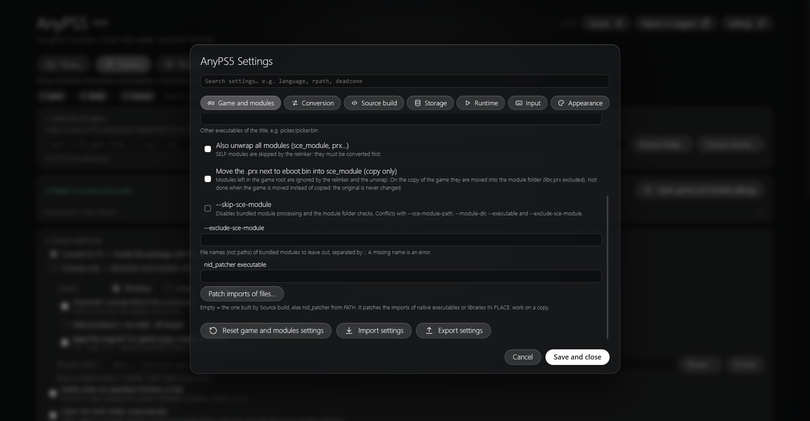
</p>

Any section can be **exported** as a small file and imported by someone else: handy to help a friend or to post a working setup for a game.

#### Runtime

GPU, language, present mode, fonts, video, audio, controller and more, all passed to the game as environment variables. A variable is only set when you change it from its default. **`ANYPS5_GPU`** suggests the GPUs detected on your computer.

<details>
<summary><strong>Full list of runtime settings</strong></summary>

<br>

| Setting | Variable | Notes |
|:--|:--|:--|
| Upscale | `ANYPS5_UPSCALE` | empty = bilinear; `fsr` = FSR 1 when the window is larger than the buffer |
| FSR sharpness | `ANYPS5_FSR_SHARPNESS` | 0.0–2.0; only with `UPSCALE=fsr` |
| FPS limit | `ANYPS5_FPS_LIMIT` | 0 = no limit, or 0.5–1000000 |
| Video-out max size | `ANYPS5_VIDEO_OUT_MAX_WIDTH` / `_HEIGHT` | Host display hints for unknown output modes |
| Overlay text size | `ANYPS5_OVERLAY_SCALE` | In-game **F10** toggles the overlay; it can be enabled from the first frame and placed in any corner |
| Host volume | `ANYPS5_VOLUME` | 0–100; empty = not set |
| Mute on focus loss | `ANYPS5_MUTE_ON_FOCUS_LOSS=1` | Mute host audio while the window is unfocused |
| Microphone device | `ANYPS5_AUDIO_IN_DEVICE` | Also: mute the microphone on focus loss |
| Pad identify | `ANYPS5_PAD_IDENTIFY` | `off` / `connect` / `always` |
| Port 0 presence | `ANYPS5_PAD_PORT0_STATE` | `default` / `controller` |
| Pad status panel | `ANYPS5_PAD_STATUS=1` | Show panel on connect / battery change (F9 still works) |
| Controller vibration | `ANYPS5_RUMBLE` | 0–100 % (can be kept on when the window loses focus) |
| Controller speaker gain | `APS5_PAD_SPEAKER_FALLBACK_DB` | 0 to −60 dB or mute |
| Date / time format | `ANYPS5_DATE_FORMAT` / `ANYPS5_TIME_FORMAT` | `0` / `1` / `2` / `auto` (time: `0` / `1` / `auto`) |
| Save free space | `ANYPS5_FREE_SPACE` | `fixed` / `host` |
| Open URLs | `ANYPS5_OPEN_URLS` | `never` / `ask` / `always` |
| PSN-only dialogs | `ANYPS5_PSN_DIALOGS` | `silent` / `show` |
| Stall prompt | `ANYPS5_STALL_PROMPT=1` | Needs `APS5_STALL_WATCHDOG_SECS`; Wait/Quit on stall |
| Autorun no pause | `ANYPS5_AUTORUN_NO_PAUSE=1` | Skip the post-autorun exit prompt |
| Run report JSON | `APS5_REPORT` | `0` / `1` for `anyps5-report.json` |
| Report no network | `APS5_NET_DISCONNECTED=1` | NetCtl and related queries report offline; sockets unchanged |
| Log file | `ANYPS5_LOG_FILE` | Absolute path |
| Host game mode | `APS5_GAME_MODE` | Feral GameMode on Linux, activity on macOS; not used on Windows |
| Host report | `ANYPS5_HOST_REPORT=1` | OS, CPU, GPU, driver and Vulkan support printed once at start; ON by default and used by *Copy for bug* |
| PlayGo unlisted chunks | `APS5_PLAYGO_UNLISTED_CHUNKS` | `installed` or `absent` |

**Advanced environment variables:** a searchable catalog of documented `ANYPS5_*` / `APS5_*` names plus a free-form `NAME=value` editor for debug switches without a dedicated control. These can make titles unstable or slower: leave them empty unless you need them.

**Test diagnostics (for bug reports)** enables extra profiling and log-timestamp variables and, on Windows, crash indirect-memory diagnostics. It can slow the game slightly, so leave it off for performance comparisons.

</details>

#### Input

Open **Settings → Input**. You can work visually or in text.

<p align="center">
  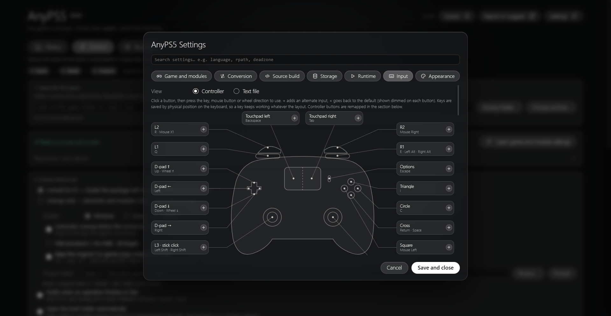
</p>

- **Visual controller editor.** Click a button on the controller, then press a key, mouse button or wheel direction. **+** adds an alternate input; **×** goes back to the default. Keys are saved by physical position, so they keep working on any keyboard layout.
- **Controller button remapping.** On a second diagram, click a button and choose which PS button it presses (for example swap Cross and Circle), or turn it off with `None`. It is saved as `SDLButton:button = Button` lines and checked when you save or import.
- **Sticks and mouse.** Deadzones with a live preview, and mouse-as-stick settings (sensitivity, vertical scale, curve, deadzone offset, max speed, smoothing, decay), plus the stick modifier and its scale.
- **Text file.** Prefer text? Switch to *Text file* and edit `anyps5-input.ini` directly, with a validity check. **Auto-reload** (`ANYPS5_INPUT_WATCH=1`) makes the game reload your keys by itself, with no need to press F1.
- **Import / export / reset** your input settings from the same screen.

<p align="center">
  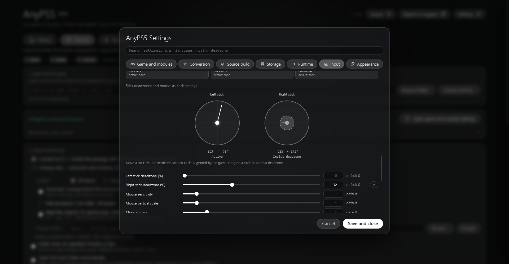
</p>

#### Appearance

- **Main color** (presets or a custom hex) and an **animated background** (soft grid, orbs or none).
- **Buttons:** a soft zoom on hover and press (can be turned off). Sections open and close smoothly and the queue panel slides in and out. Animations stop automatically if your system asks for reduced motion.
- **Sound effects:** short sounds generated by the app (no audio files) for buttons, tabs, dialogs, success and errors, with a volume slider. They only play while the window has focus.
- **Discord Rich Presence** can be turned off here ([details below](#discord-rich-presence)).

<p align="center">
  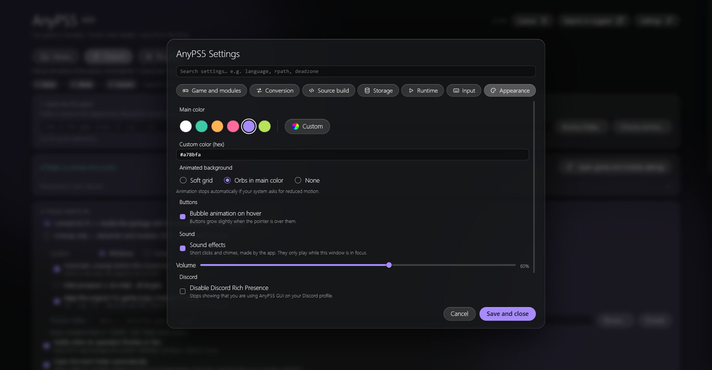
</p>

#### Storage

Shows where the app keeps its tools, builds, backups and `config.ini`, and moves everything to another folder with one click.

### Reports and updates

**Reports**

- **Run report summary.** When the game closes, the log shows what AnyPS5 recorded in `anyps5-report.json`: stage reached, average FPS, frame times (p50, p90, p99), missing functions, shader problems and how the game ended. It is also included in *Copy for bug* and the *Debug package*.
- **Export report…** (below the log) saves a text file with your GUI build, title ID and content version, CPU, OS, GPU, power source, system, runtime variables, `--to-intel`, how far the game got, exit code and presents per 10 s, plus the full log and an automatic reading of it (software renderer, stalled title, device lost, GPU out of memory, missing permissions, host-import memory budget and texture-cache diagnostics with notes about the matching tuning variables…). Measured data and the automatic reading are kept apart; fields the GUI cannot know are left as *(fill in)*. Known errors (NVIDIA driver crash, `/dev/udmabuf`, out of memory, error 126/193, lost execute permission, duplicate output names) are explained with what to do.
- **Copy for bug** copies a short report (versions, host report, last 60 log lines) to paste in a GitHub issue.
- **Debug package…** saves a zip with the bug report, the full report, your settings, the `.registry.json` files and any errors the app handled without showing them (also kept in `hidden-errors.log` in the data folder).
- User name, computer name and home folder are hidden in all of these: **check the content before you share it.**
- **Report or suggest** (top bar) opens this project's GitHub issues with your app version and system already filled in. You need a GitHub account to post; nothing else is sent.

**Updates**

- **The app itself:** it checks this repository's latest release and, when a newer one exists, can download it, replace itself and restart.
- **The tools repository** (with *Build from GitHub source*): the app compares the remote commit with the one you built, without downloading anything. If it is the same, nothing is fetched or built. If it is newer, a popup shows the date, the latest commit titles and a link to all the changes on GitHub, and you choose **Update and rebuild** or **Keep this build**. *Do not show this message again* saves your choice (see *Ask before updating and rebuilding* in [Advanced](#settings-reference)).

### Discord Rich Presence

While the app is open and Discord is running on the same computer, your profile shows *In the launcher* with the status *Idle*. During an operation it shows the current phase with an elapsed-time counter: *Converting game* or *Unwrapping game* (with the current step), *Downloading tools*, *Building converter (relinker)*, *Restoring backup* (no timer) and *Playing a converted game*. When the operation ends or is cancelled, it goes back to *In the launcher*. It never shows which game you play. The presence has a *Get AnyPS5 GUI* button (also on the logo) that opens the [Download](#download) section; Discord does not show it on your own profile, only to other users. If Discord is not running, the presence is silently skipped. Turn it off with *Disable Discord Rich Presence* in Appearance: it takes effect immediately.

---

## Where the tools come from

The relinker, libs and `unwrap_self.py` are chosen in **Tools and updates: where they come from** (Convert page → Start):

| Source | What it does |
|:--|:--|
| **Local files (manual)** | Uses files you provide. Press **Import files…** and pick `unwrap_self.py`, `relinker-*` and `prx-*.zip` (optionally `nid_patcher`, `anyps5-input.ini`, fonts `.ttf`/`.otf`/`.ttc`, `import_audit.py` and `pad_input.py`). They are copied into the app folder; if a file already exists you are asked whether to replace it. |
| **Release from GitHub repo (auto-update)** | Downloads the latest release (or a tag you choose) of a GitHub repository with **Download now**. The web input mapper (`tools/input-mapper`) is not a release file, so it is downloaded from the source of the same tag the first time you open it. |
| **Build from GitHub source (auto-update)** | Clones the repository and builds it with **Build now**. Needs git, CMake and a C/C++ compiler. |

**Download now** and **Build now** are disabled while an operation runs; **Stop** next to them cancels it. By default both GitHub sources point to the official [AnyPS5](https://github.com/boykopovar/AnyPS5) repository, but the repository is just a setting: see [Advanced](#advanced-forks-and-custom-builds).

---

## Installation & requirements

1. Open the [**Releases**](https://github.com/Lenny4250gh/AnyPS5-GUI/releases/latest) page and download the file for your system (see [Download](#download)).
2. *(Optional but recommended)* **verify the file** by comparing its SHA-256 with the `sha256:` value GitHub shows next to each file on the release page:
   - Windows (PowerShell): `Get-FileHash .\AnyPS5_GUI-windows.exe -Algorithm SHA256`
   - Linux: `sha256sum AnyPS5_GUI-linux`
   - macOS: `shasum -a 256 AnyPS5_GUI-macos.zip`
3. **Run it.** The first time it creates an `AnyPS5_GUI` folder in your user data folder (so it survives updates), where it keeps the downloaded tools, `config.ini`, backups and so on. You can move it from **Settings → Storage**. To keep everything next to the program instead, put an empty file named `portable` next to it.

   | System | Default app folder |
   |:--|:--|
   | Windows | `%APPDATA%\AnyPS5_GUI` (Roaming) |
   | macOS | `~/Library/Application Support/AnyPS5_GUI` |
   | Linux | `~/.local/share/AnyPS5_GUI` |

> [!NOTE]
> All three files are built automatically by GitHub Actions on real Windows, macOS and Linux machines, straight from the source in this repository. You can inspect the [workflow](.github/workflows/build.yml) and the [build runs](https://github.com/Lenny4250gh/AnyPS5-GUI/actions).

### Requirements and warnings

| System | What to know |
|:--|:--|
| **Windows** | Needs the Microsoft Edge WebView2 runtime (already present on up-to-date Windows 10/11). SmartScreen or your antivirus may warn about the file: it is not code-signed, and PyInstaller one-file programs are often flagged as false positives. If you don't trust the binary, read the source and [build it yourself](#build-from-source). |
| **macOS** | The app is not signed. Right-click the app → **Open** the first time (or run `xattr -cr AnyPS5_GUI.app`). |
| **Linux** | The binary bundles its own Qt window backend: nothing to install. It is built on Ubuntu 22.04, so it runs on glibc 2.35 or newer (Ubuntu 22.04+, Linux Mint 21+, Debian 12+, Fedora 36+…). From source, see [Build from source](#build-from-source). |

### Upgrading from an older version

The first versions kept a `Utilities/` folder next to the program. On startup the app moves it automatically to the new location (your user data folder, or the one chosen in **Settings → Storage**):

- Only what the app uses is moved: tools (`unwrap_self.py`, `relinker-*`, `prx-*.zip`, `tools/`), `config.ini`, `anyps5-input.ini`, backups, fonts and 7-Zip files.
- Items that already exist in the new folder are not overwritten, and any other file you left in the old folder stays where it is. The old folder is removed (sent to the trash) only if nothing else is left in it.
- The big folders `release/`, `source/`, `toolchain/`, `extracted/` and `update/` are moved only if the old and new folders are on the same drive; otherwise they stay behind and are downloaded or rebuilt when needed.

---

## Advanced: forks and custom builds

The **Repository URL** field is not tied to AnyPS5. Point the GUI at a **fork** or any repository with the same layout and it will download its releases or build it from source: useful to try a fork with extra fixes, a branch in development or an older version. Switching back to the official repository is just a matter of clearing the field.

<a id="settings-reference"></a>

### Settings reference

| Setting | Used by | Meaning |
|:--|:--|:--|
| **Repository URL** | Release, Build | Accepts `https://github.com/owner/repo`, `github.com/owner/repo` or `owner/repo`. Empty = the official repository. **Release** only works with `github.com` URLs; **Build** also accepts any URL `git` can clone (`https`, `ssh`, `git`, `file`, `user@host:path`). |
| **Release tag** | Release | Empty = latest release. Set e.g. `v0.1.2` to pin a version. |
| **Check for a newer release before every run** | Release | ON = asks GitHub which release is current and downloads only the missing files. OFF = reuses what was downloaded (works offline). |
| **Branch or tag** | Build | Empty = the repository's default branch. |
| **CMake target** | Build | Empty = tries `relinker` first and, if it does not exist, builds everything. Also the name of the executable to pick up. |
| **Extra CMake arguments** | Build | Added to the configure step, e.g. `-G Ninja -DCMAKE_CXX_COMPILER=clang++`. Without your own choice, the GUI adds the Ninja generator (Linux/macOS, if installed) and a compiler cache (`ccache` or `sccache`, if installed). |
| **Check for updates before every relink** | Build | ON = checks the latest commit and rebuilds only if it changed. OFF = reuses the existing build. |
| **Ask before updating and rebuilding** | Build | ON (default) = when a build exists and the repository is newer, a popup asks whether to update or keep it. OFF = no question: follows *Check for updates before every relink*. |
| **Extra arguments** | Conversion | Relinker options the GUI does not know yet, e.g. `--new-option 1`. |
| **Build the libs (.prx) from the repository** | Build | ON = also builds the `libs` target and uses those libs instead of a `prx-*.zip`. Much slower (full CMake configuration, downloads FFmpeg, needs the SDL/Vulkan build dependencies). |
| **Build jobs** | Build | Empty = automatic: about half of your CPU threads, more with a lot of RAM. A higher number builds faster but uses more RAM; lower it if the PC slows down. An interrupted build resumes where it stopped. |

Unofficial repositories show a warning ("run only code you trust"), also written in the log together with the repository and tag/branch used.

### Folder layout

Each repository gets its own folder, so testing a fork never mixes files with the official one:

```
AnyPS5_GUI/              (the app folder)
├── release/<repo>/<tag>/    files downloaded from a GitHub release
├── source/<repo>-<hash>/    clone + CMake build of a repository
└── ...                      files imported manually (Local source)
```

### What a repository must contain

<details>
<summary><strong>For the Release source</strong></summary>

<br>

The GUI asks the GitHub API for the release (`latest`, or the tag you set) and looks at its **assets** by name (case-insensitive):

| Asset | Required | Rules |
|:--|:-:|:--|
| `relinker-*` | yes | The relinker executable **for the OS the GUI runs on**. On Windows it must end in `.exe`; on Linux/macOS it must have no extension (`relinker-v0.1.2` is fine; `.zip`, `.md`, `.txt`, `.json`, `.sha256`… are ignored). If several match, the last in alphabetical order (the newest) is used. |
| `prx-*.zip` | yes | The system libs. The zip must contain a folder named `libs` or `libs-<system>` (`libs-windows`, `libs-linux`, `libs-macos`; the system-specific one is preferred). It is read as it is, no need to extract it. If the name contains `windows` or `linux`, the right one is chosen for the target (**macOS uses the `linux` zip**); otherwise any `prx-*.zip` is used. |
| `USAGE.md`, `INPUT_MAPPING.md`, `release-notes.md` | no | Small documentation files, downloaded if present. |

`unwrap_self.py` is **not** a release asset: it is downloaded from `tools/unwrap_self.py` **at the same tag** of the repository. If that tag does not contain it, the GUI falls back to the default branch (and warns you), then to the copy in the app folder.

Downloads are verified against the SHA-256 that GitHub publishes for each asset. If GitHub cannot be reached, the release already downloaded is reused. GitHub allows about 60 API requests per hour without a token: set the `GITHUB_TOKEN` (or `GH_TOKEN`) environment variable to raise the limit.

Minimal example of a compatible release:

```
v1.2.3
├── relinker-v1.2.3.exe        (Windows build of the relinker)
├── relinker-v1.2.3            (Linux/macOS build, no extension)
├── prx-windows-v1.2.3.zip     (contains libs/ or libs-windows/)
├── prx-linux-v1.2.3.zip       (contains libs/ or libs-linux/)
└── USAGE.md                   (optional)
```

and, in the repository at the same tag: `tools/unwrap_self.py`.

</details>

<details>
<summary><strong>For the Build from source option</strong></summary>

<br>

The GUI runs a shallow `git clone --recurse-submodules --depth 1` (without tags, with parallel jobs; `--branch <ref>` if you set one), then CMake in `Release` mode. Your repository needs:

- A **`CMakeLists.txt` in the root**. Without it the build stops with an error.
- A CMake target that produces the relinker, by default **`relinker`** (or your own in *CMake target*). The GUI finds the built executable by looking for a file whose name contains the target name.
- Support for **`-DANYPS5_RELINKER_ONLY=ON`**, which the GUI passes automatically so the relinker is built without SDL, Vulkan and FFmpeg (your own value in the extra arguments wins).
- The AnyPS5 folder layout (`core/`, `3rdparty/`, `cmake/`, `tools/`). A missing one is only a warning, but a very different layout probably will not work.
- **`tools/unwrap_self.py`**, used for the Unwrap step (the cloned copy replaces the one in the app folder). Optional: `tools/pad_input.py` and `tools/import_audit.py`, picked up from the clone if present.

If you also enable **Build the libs from the repository**, the repo must have a CMake target **`libs`** whose output goes to `<build>/core/libs/libs/*.prx`. Only the `.prx` files that match the folder names under `core/libs/prx/` are kept, as in the official `tools/package_release.py`.

The build is remembered by **commit and target**: the GUI reads the remote commit without downloading anything, and if neither it nor your build settings changed, the existing relinker is reused. The log shows a progress bar that follows CMake/Ninja's `[N/TOTAL]` steps (also for the `libs` target), with elapsed and remaining time and the total time at the end.

**Tools needed.** `git`, `cmake` and a C/C++ compiler must be in your `PATH` (Debian/Ubuntu: `sudo apt install git cmake build-essential`). On Windows the project supports only the MinGW-w64 GCC 15.2.0 (WinLibs, with Ninja) toolchain; the GUI can install git, CMake and that toolchain for you with one click (about 270 MB, saved in `toolchain/` inside the app folder, with a progress bar for the download and the unpacking). Visual Studio cannot link this project.

**Paths with spaces.** The repository's CMake passes the libs build's `-include` path to the compiler without quotes. When the folder path contains a space (e.g. `AnyPS5 GUI`), the GUI quotes it for you in its cloned copy, and gives CMake a space-free path to the toolchain (the 8.3 short path, or a junction in the temp folder). If you still get path errors, use a short folder without spaces (e.g. `C:\AnyPS5`).

</details>

### Quick checklist for a fork

1. **Fork** [AnyPS5](https://github.com/boykopovar/AnyPS5) and push your changes. Don't rename `tools/unwrap_self.py`, the `relinker` target or the top-level folders.
2. **To test from source:** choose *Build from GitHub source*, enter `your-name/AnyPS5` as the repository, optionally a branch, then press **Build now**.
3. **To distribute a version:** create a GitHub release with `relinker-<version>[.exe]` and `prx-<system>-<version>.zip` files named as above. Anyone can then choose *Release from GitHub repo*, enter your repository and get it.

> [!CAUTION]
> Only point the GUI at repositories you trust: both options download and then **run** code (the relinker and `unwrap_self.py`) from that repository on your computer.

---

## Build from source

Requires Python 3.9+ (3.11 is what the CI uses).

```bash
git clone https://github.com/Lenny4250gh/AnyPS5-GUI.git
cd AnyPS5-GUI
pip install -r requirements.txt
python AnyPS5_GUI.py          # run directly
```

`AnyPS5_GUI.py` only starts the app: the code is in the `anyps5_gui/` folder next to it, so keep the two together (`git clone` already gives you both). On Linux, pywebview needs a GUI backend: Qt (installed by `pip install -r requirements.txt`) or GTK and WebKitGTK from your distribution (`sudo apt install python3-gi gir1.2-gtk-3.0 gir1.2-webkit2-4.1`; on older releases the package is `gir1.2-webkit2-4.0`), see the [pywebview docs](https://pywebview.flowrl.com/guide/installation.html). If none is found, the app shows a message explaining what to install.

To build the executable you also need PyInstaller and Pillow:

```bash
pip install pyinstaller pillow
python build.py               # asks for the target OS
python build.py 3             # no questions: 1 = Windows, 2 = macOS, 3 = Linux
```

`build.py` embeds `index.html` into the executable and calls PyInstaller. PyInstaller cannot cross-compile, so build **on** the system you are targeting (or let GitHub Actions do it). The result is in `dist/`.

---

## Support

| Problem with… | What to do |
|:--|:--|
| **This GUI** (it doesn't open, a button does nothing, a wrong option) | Use **Report or suggest** in the app, or open an [issue](https://github.com/Lenny4250gh/AnyPS5-GUI/issues). Include your OS, the GUI version and any error shown; for game problems paste **Copy for bug** or attach the file from **Export report…** / **Debug package…**. |
| **AnyPS5 itself** (a game doesn't start, crashes, missing library functions) | This GUI cannot fix them. Attach the report from **Export report…** and ask in the official [AnyPS5 Discord](https://discord.gg/BHFztBPUe) or the [Game bring-up discussions](https://github.com/boykopovar/AnyPS5/discussions/categories/game-bring-up), and read the [usage guide](https://github.com/boykopovar/AnyPS5/blob/main/docs/user/USAGE.md). |

---

## About this project's development

AnyPS5 GUI was built with "vibe coding": I described what I wanted and used AI tools to write much of the code, then tested and adjusted the result myself. Because of this, the code may contain mistakes or non-idiomatic solutions that a hand-written project might not. If something does not work as expected, please [open an issue](https://github.com/Lenny4250gh/AnyPS5-GUI/issues). Pull requests and suggestions are welcome.

---

## License

GPL-2.0-only, see [LICENSE](LICENSE). The GUI loads the official `unwrap_self.py` from the AnyPS5 project (GPL v2 only) and does not contain a copy of it. If you redistribute it together with the GUI, include its license and sources.

## Credits

[AnyPS5](https://github.com/boykopovar/AnyPS5) by its authors, which does the real work (relinker, system libraries, `unwrap_self.py`). This GUI only makes it easier to use.

## Disclaimer

For interoperability, research, preservation and compatibility purposes only. This project does not include, distribute or require copyrighted software, firmware, cryptographic keys or proprietary libraries. You are responsible for obtaining and using any binaries in accordance with applicable laws and license terms. Provided "as is", without warranty.
